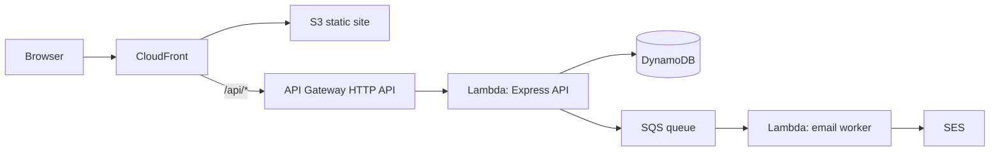

# AWS Serverless Auth Service

A design-first authentication service for a small login-gated website. It covers the full account lifecycle on AWS without a fixed server bill: email/password registration, email verification, sign-in, optional email-code MFA, password reset, rate limiting, and short account lockouts.

> **Status: design phase.** No application code has been written yet. The implementation contract is [docs/design.md](docs/design.md).

## Why this project

The goal is a cloud/backend portfolio project that demonstrates practical AWS design decisions, not just a CRUD demo moved onto an EC2 instance. The service is intentionally small, but it exercises the parts of authentication that are easy to get wrong: verification codes, session cookies, MFA, abuse controls, and asynchronous email delivery.

The design targets **under $5/month at low traffic**, excluding domain registration.

## Planned capabilities

- Register with email and password; verify the email with a 6-digit code.
- Sign in and sign out; keep the session across refreshes.
- Optional email-code MFA, disabled by default and enabled from account settings.
- Forgot-password and reset-password flows using the same email-code mechanism.
- Rate limiting for login, registration, code sending, password reset, and MFA.
- Short account lockouts after repeated password or MFA failures.
- A minimal authenticated `/app` area and a public `/resend-verification` page.

## Architecture



The React site and the API share one CloudFront distribution, so the browser sees a single origin and session cookies stay simple. The API is an Express application packaged for Lambda with `serverless-http`; DynamoDB holds users, sessions, verification codes, and rate-limit counters. SES delivery is decoupled through SQS so a slow or failed email send does not block an HTTP request.

## Planned stack

| Layer | Choice |
|---|---|
| Frontend | React + Vite + JavaScript, React Router |
| API | Node.js 22, Express, `serverless-http` |
| Compute | AWS Lambda behind API Gateway HTTP API |
| Data | DynamoDB, four on-demand tables |
| Email | SES, fed by an SQS queue and a worker Lambda |
| Infrastructure | AWS CDK (TypeScript) |
| CI/CD | GitHub Actions with OIDC to AWS |
| Observability | CloudWatch logs, metrics, alarms; X-Ray tracing |
| Region | `ap-southeast-1` by default, with `us-east-1` for the global edge certificate |

## Repository layout

```text
.
├── README.md
├── docs/
│   ├── design.md          # full design, flows, data model, API, security, deployment
│   └── adr/
│       └── 0001-serverless-authentication.md
├── .gitignore
└── (application and infrastructure code will be added after design approval)
```

## Documentation

- [Design document](docs/design.md) — goals, non-goals, architecture, DynamoDB model, API contract, security controls, frontend routes, CDK deployment, cost estimate, risks, and acceptance criteria.
- [ADR 0001](docs/adr/0001-serverless-authentication.md) — why the project uses a serverless, self-managed authentication stack.

## Security baseline

The design deliberately keeps a small set of non-negotiable controls even in the MVP:

- Passwords hashed with bcrypt, cost factor 12.
- Verification and MFA codes stored as HMAC-SHA256 digests, never plaintext.
- Short-lived, single-use codes with attempt limits and resend cooldowns.
- `HttpOnly`, `Secure`, `SameSite=Lax` session cookies.
- Generic error messages that do not reveal whether an account exists.
- Rate limits and lockouts enforced in DynamoDB, not only in process memory.
- No secrets in source control; runtime secrets come from Secrets Manager.

## Cost target

The design is sized for a personal project: API Gateway, Lambda, DynamoDB on-demand, S3, CloudFront, SES, SQS, and CloudWatch are expected to total roughly **$1–3/month** at low traffic, with a hard budget target below **$5/month**. Domain registration is separate.

## Roadmap

- [x] Write and review the serverless design.
- [ ] Approve the design and create the implementation plan.
- [ ] Build the authentication API and DynamoDB access layer.
- [ ] Build the React account flows.
- [ ] Add CDK infrastructure and GitHub Actions deployment.
- [ ] Deploy to a development AWS account and run the acceptance tests.

## License

TBD. No license has been granted yet.
