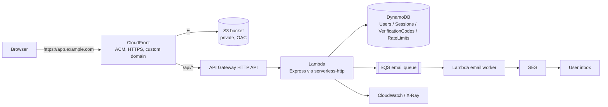

# Design: Serverless Authentication Service on AWS

- Status: Design draft - implementation not started
- Date: 2026-11-07
- Scope: Version 1 (MVP)
- Authentication: self-managed, no Cognito
- Deployment: AWS serverless
  - API Gateway HTTP API + Lambda (Node.js 22)
  - DynamoDB (4 tables, on-demand)
  - S3 + CloudFront (React static site)
  - SES + SQS + Lambda (asynchronous email delivery)
  - CDK (TypeScript) + GitHub Actions with OIDC
- Budget target: **under $5/month** at low traffic, excluding domain registration

All paths in this document are relative to the repository root. No application code has been written yet; this document describes the intended implementation.

## Table of contents

1. [Purpose and rationale](#1-purpose-and-rationale)
2. [Goals and non-goals](#2-goals-and-non-goals)
3. [Constraints](#3-constraints)
4. [Design history and options considered](#4-design-history-and-options-considered)
5. [Version 1 scope](#5-version-1-scope)
6. [User flows](#6-user-flows)
7. [Technical architecture](#7-technical-architecture)
8. [DynamoDB data model](#8-dynamodb-data-model)
9. [API design](#9-api-design)
10. [Sessions and security](#10-sessions-and-security)
11. [Email and asynchronous delivery](#11-email-and-asynchronous-delivery)
12. [Frontend](#12-frontend)
13. [Key decisions](#13-key-decisions)
14. [Acceptance criteria](#14-acceptance-criteria)
15. [Test plan](#15-test-plan)
16. [Deployment and operations](#16-deployment-and-operations)
17. [Cost estimate](#17-cost-estimate)
18. [Risks and open questions](#18-risks-and-open-questions)
19. [Left to the implementer](#19-left-to-the-implementer)
- [Appendix A: AWS service map](#appendix-a-aws-service-map)
- [Appendix B: MFA, 2FA, and the reference implementation](#appendix-b-mfa-2fa-and-the-reference-implementation)
- [Appendix C: Glossary](#appendix-c-glossary)

---

## 1. Purpose and rationale

### 1.1 What this project is

A small "login-first" website:

- A visitor can register, verify their email, sign in, sign out, and reset a forgotten password.
- After sign-in there is a minimal `/app` placeholder page; a blog or project description can live there later.
- Registration and password reset are completed with a 6-digit code sent by email.
- A user can enable email-code MFA in settings; it is off by default.
- Login, registration, code sending, and MFA verification are rate limited. Repeated password or MFA failures trigger a short account lockout.

It is not an employee management system and not a blog. Version 1 completes the account lifecycle and nothing more.

### 1.2 Why serverless

The goal is a cloud/backend portfolio project that must not carry a fixed $50–90/month bill. Serverless satisfies three requirements at once:

1. **Cost**: pay per request at low traffic; no idle EC2 or RDS invoice.
2. **Cloud-native**: API Gateway, Lambda, DynamoDB, SQS, SES, CloudFront, CDK, and IAM are real managed services, not a single host moved into the cloud.
3. **Deliverable**: no VPC, NAT, RDS Proxy, or load balancer is needed, so version 1 can ship in a short time.

The costs of this choice must be stated as well:

- Lambda has cold starts; login p95 may be higher than a long-running process.
- DynamoDB requires designing access patterns up front; there is no ad-hoc join.
- Local development needs DynamoDB Local, so the debugging path is longer than SQLite.
- Asynchronous email failures, delayed TTL deletion, and eventual consistency all need explicit handling.

These costs are part of what the project demonstrates; they are not problems to hide.

### 1.3 Audience

- People who want to register and sign in to the site.
- People who want to read the code and the deployment story.
- Engineers reviewing whether the author actually understands authentication in the cloud.

---

## 2. Goals and non-goals

### 2.1 Goals

- Complete the loop: register -> verify email -> sign in -> session -> sign out -> reset password.
- Support optional email-code MFA, off by default.
- Rate limit login, registration, code sending, and MFA verification; lock accounts after repeated password or MFA failures.
- Deploy on AWS using API Gateway, Lambda, DynamoDB, S3, CloudFront, SES, SQS, CloudWatch, IAM, and CDK.
- Serve frontend and API from the same origin (CloudFront forwards `/api/*` to API Gateway), so cookies never need to be cross-site.
- Provide automated tests, CDK deployment, GitHub Actions CI/CD, basic alarms, and a cost alarm.
- Keep the monthly cost under $5 at low traffic, excluding the domain.

### 2.2 Non-goals

- The content of the blog or project description itself.
- An admin console, user management, or an audit-log query page.
- Third-party sign-in (Google/GitHub), passkeys, or TOTP.
- Multi-region, high availability, or load testing to very high concurrency.
- A complete WAF or anti-fraud system; version 1 relies on coarse API Gateway throttling plus application-level rate limiting.
- A custom email template system; version 1 sends plain-text email.
- Copying the reference project `Two_Factor_Auth` as-is.

### 2.3 Anti-goals (reaching any of these is a failure)

- Passwords, verification codes, or session tokens stored or logged in plaintext.
- Using `Scan` to look up users or verification codes.
- A public S3 bucket, or an IAM policy containing `*`.
- Putting a JWT in `localStorage`.
- Splitting the system into microservices merely to look cloud-native, so that the split cannot be justified.
- Implementing rate limiting or lockout as in-process memory counters, which do not work across Lambda instances.
- Deploying without a cost alarm and losing control of the monthly bill.

---

## 3. Constraints

- Frontend: Vite + React (JavaScript, no TypeScript), React Router, Tailwind CSS; no UI component library.
- Backend: Node.js; an Express application runs on Lambda through `serverless-http`.
- Lambda runtime: `nodejs22.x`; developer machines run Node 24, so the code stays compatible with both 22 and 24.
- Database: DynamoDB on-demand; 4 tables; no GSI in version 1; no `Scan`.
- Email: SES; the development environment uses a console adapter and does not send real mail.
- Infrastructure: AWS CDK (TypeScript, confined to `infra/`).
- Region: `ap-southeast-1` (Singapore) by default; the CloudFront certificate lives in `us-east-1`.
- Domain: custom domain with ACM and Route 53; if no domain is available yet, use the CloudFront default domain name.
- Budget: under $5/month at low traffic; AWS Budgets alarm configured.
- Verification code rules: 6 digits, valid for 10 minutes, at most 5 attempts, 60-second resend cooldown, single use.
- Password: bcryptjs cost 12; minimum 8 characters; maximum 72 bytes (bcrypt limit).
- Session: 7 days; `HttpOnly` + `Secure` + `SameSite=Lax`; the database stores only the SHA-256 of the token.
- MFA: optional, off by default; email codes only; no TOTP and no recovery codes.

---

## 4. Design history and options considered

### 4.1 Earlier iteration

An earlier iteration of this design ran Express and SQLite on a single host. The product behavior was the same; the runtime was replaced because it carried a fixed monthly cost, a single point of failure, and little cloud-native surface. The table records what changed and what deliberately did not.

| Dimension | Earlier iteration (single host) | Current design (serverless) |
|---|---|---|
| Runtime | Express on one machine | API Gateway + Lambda |
| Database | SQLite file | DynamoDB |
| Sessions | SQLite `sessions` table | DynamoDB `Sessions` table + HttpOnly cookie |
| Rate limiting | SQLite counters | DynamoDB atomic counters + TTL |
| Verification codes | SQLite | DynamoDB + TTL |
| Email | Local console / SES | SQS + Lambda worker + SES |
| Frontend hosting | Local static files | S3 + CloudFront |
| Infrastructure | Manual or scripts | CDK |
| Cost model | Fixed server | Pay per request |
| Local development | Run Express directly | Express + DynamoDB Local; email through console |
| Public entry point | EC2 with a public IP | CloudFront domain (no public IP) |

**Invariants carried over unchanged:** bcrypt password hashing, verification codes stored only as HMAC, `HttpOnly` + `Secure` + `SameSite=Lax` cookies, uniform error messages, no sensitive data in logs, parameterized or expression-based data access, and no tokens in `localStorage`.

### 4.2 Options considered

| Option | Authentication logic | Infrastructure | Monthly cost (low traffic) | Learning value | Main risk |
|---|---|---|---|---|---|
| A. Cognito + custom UI | Cognito manages passwords, sessions, verification | Cognito + API Gateway + Lambda | Low | Medium (learns Cognito peripherals) | Black box; lockout and rate-limit behavior constrained by the managed service |
| B. Cognito Hosted UI | Cognito end to end | Amplify/Cognito | Low | Low (too little code) | Pages are not controllable; the project looks thin |
| C. Self-managed + EC2 + Express + SQLite | Written by hand | EC2 + Caddy + SQLite | $10–15 | High, but mostly traditional operations | Single point of failure, fixed cost, little cloud-native content |
| D. Self-managed + serverless (selected) | Written by hand | API Gateway + Lambda + DynamoDB + S3/CloudFront + SES/SQS + CDK | $1–3 | High (authentication plus cloud-native) | Cold starts, DynamoDB modeling, asynchronous pipeline complexity |

### 4.3 Why option D

- The project targets cloud/backend work; option D demonstrates "using managed services to solve a concrete problem" rather than "running Express on EC2".
- The cost fits the hard constraint of not accepting $50–90/month.
- Authentication logic remains ours: password hashing, verification codes, sessions, rate limiting, and lockout can all be explained.
- No VPC, NAT, or RDS is required, so the version 1 scope stays controllable.

**Why not Cognito:** the learning objective is to implement authentication by hand; Cognito would turn the most interesting part into configuration.

**Why not ECS Fargate + RDS:** the architecture would be closer to production, but the fixed cost is roughly $50–90/month, which is explicitly unacceptable. It remains a possible migration path if budget appears later.

---

## 5. Version 1 scope

### 5.1 In scope

- Registration (email + password) with a 6-digit verification code.
- Email verification; an unverified email cannot sign in.
- Login (email + password).
- Optional email-code MFA: enable or disable in settings; when enabled, login takes one extra code step.
- Logout.
- Staying signed in across page reloads (7-day session).
- Forgot password and password reset (6-digit email code).
- A resend-verification page at `/resend-verification`.
- `/app` placeholder page plus route guard.
- Rate limiting for login, registration, code sending, and MFA.
- Lockout for 15 minutes after 5 password failures; 15 minutes after 10 MFA failures.
- AWS deployment: API Gateway, Lambda, DynamoDB, S3, CloudFront, SES, SQS, CloudWatch, Secrets Manager, IAM, CDK.
- GitHub Actions: test, build, CDK synth/deploy, frontend release.
- Baseline alarms: Lambda errors, API 5xx, DLQ, DynamoDB throttling, SES bounces.
- Cost alarm.

### 5.2 Out of scope

- Blog or project description content.
- Admin console, user list, audit-log queries.
- Third-party sign-in, passkeys, TOTP, SMS.
- Multi-region, high availability, disaster-recovery drills.
- WAF, CAPTCHA images, device fingerprinting, risk scoring.
- Custom email templates and open-rate tracking.
- MFA recovery codes; a lost mailbox is handled manually by an operator.
- A public landing page (undecided; see 18.1).

### 5.3 Security baseline (non-negotiable)

- Hash passwords with bcrypt; never store plaintext.
- Store verification codes only as HMAC-SHA256; never store plaintext and never return the code to the client.
- Store only the SHA-256 of session tokens; the cookie is `HttpOnly`/`Secure`/`SameSite=Lax`.
- Use uniform wording for login failures; do not reveal whether an email exists.
- Keep rate-limit and lockout state in DynamoDB, never in process memory.
- Use only `GetItem`, `Query`, `PutItem`, `UpdateItem`, and `DeleteItem` against DynamoDB; never `Scan`.
- Apply least-privilege IAM; block public S3 access; keep keys in Secrets Manager.
- Never log passwords, verification codes, cookies, or complete tokens.
- On every write endpoint, validate `Content-Type: application/json` and the `Origin` header (same origin).

---

## 6. User flows

### 6.1 Registration and email verification

1. The user opens `/register` and enters email, password, and password confirmation.
2. The frontend validates format and length, then submits `POST /api/auth/register`.
3. The server normalizes the email (trim + lowercase).
4. The server checks whether the user already exists in `Users`:
   - Exists: return `409 EMAIL_ALREADY_REGISTERED`; the page suggests "If this is your address, sign in or resend the verification email".
   - Does not exist: hash the password with bcrypt; write the `Users` item (`email_verified_at` absent); generate a 6-digit code; write `VerificationCodes`; enqueue an email job in SQS.
5. Return `201`. The frontend navigates to `/verify-email?email=...`.
6. The user receives the email and enters the 6-digit code, submitting `POST /api/auth/verify-email`.
7. The server loads the newest code, verifies the hash, expiry, attempt count, and purpose; on success it sets `email_verified_at` and marks the code consumed.
8. Return `200`; the frontend navigates to `/login` and reports that the email is verified.

**Failure handling:**

- Wrong code: `400 INVALID_CODE`; the remaining attempt count is not disclosed, only "the code is incorrect or has expired".
- Expired code: same as above.
- Resend: `POST /api/auth/resend-verification`; 60-second cooldown per email, at most 3 sends in 15 minutes; always returns `200` without revealing whether the email exists. If the account is already verified (`email_verified_at` present), it still returns `200` but sends no new code, changes no verification state, and does not reveal whether the account is verified.
- Queue failure: the registration endpoint returns `503 EMAIL_QUEUE_UNAVAILABLE`; the user can resend later. The user record already exists, so resending does not require registering again.

### 6.2 Login

1. The user opens `/login` and enters email and password.
2. The frontend submits `POST /api/auth/login`.
3. The server:
   - Loads the user by email; when the user does not exist, performs one comparison against a fixed dummy bcrypt hash to avoid a timing difference.
   - Checks `locked_until`; if still locked, returns `423 ACCOUNT_LOCKED` with `Retry-After`.
   - Verifies the password; on failure atomically increments `failed_login_count`, and at 5 failures sets `locked_until = now + 15min`, returning `401 INVALID_CREDENTIALS`.
   - If the password is correct but the email is unverified: return `403 EMAIL_NOT_VERIFIED`; the frontend points the user to verification or resend.
   - If the password is correct and `mfa_enabled = false`: create a session, set the cookie, return `200 { user }`.
   - If the password is correct and `mfa_enabled = true`: generate a 6-digit code (purpose `mfa_login`), issue an `mfaToken` (HMAC, 10 minutes), and return `200 { mfaRequired: true, mfaToken }` **without setting a session cookie**.
4. The frontend keeps `mfaToken` in memory (React state) and navigates to `/mfa`.
5. The user enters the email code and submits `POST /api/auth/mfa/verify` with `mfaToken` and `code` in the body.
6. The server verifies the signature and expiry, loads the user, checks that `session_version` matches the token, checks lockout, loads the newest code, and verifies it; on success it creates a session, sets the cookie, and returns `200 { user }`.
7. On failure: `401 INVALID_CODE`; the code's `attempts` is incremented; after 5 attempts that code is void; `failed_mfa_count` is incremented; at 10 failures the account is locked for 15 minutes and the response is `423`.

**Resending the MFA code:** `POST /api/auth/mfa/resend` with `mfaToken` in the body; 60-second cooldown; at most 3 sends per account in 15 minutes; returns `200` without returning a new code.

### 6.3 Session restore on page reload

1. On startup, `AuthProvider` calls `GET /api/auth/me`.
2. The server reads the cookie, hashes it with SHA-256, and loads the `Sessions` item; missing or expired -> `401`.
3. The server loads `Users` and compares `session_version`; a mismatch deletes the session and returns `401`.
4. The server returns `{ user }`; the frontend renders `/app`.
5. On any `401` from `/api/*`, the frontend clears the user, navigates to `/login`, and carries the current path as `from`.

### 6.4 Logout

1. `POST /api/auth/logout`.
2. The server deletes the `Sessions` item, clears the cookie, and returns `204`.
3. The frontend clears the user and navigates to `/login`.

### 6.5 Forgot password and password reset

1. `/forgot-password` accepts an email; `POST /api/auth/forgot-password`.
2. Whether or not the email exists, return `200`; when it exists, generate a `reset_password` code and enqueue the email.
3. `/reset-password?email=...` accepts the 6-digit code and a new password; `POST /api/auth/reset-password`.
4. The server verifies the code; on success it:
   - updates `password_hash`
   - increments `session_version` (invalidating every old session)
   - clears `failed_login_count`, `failed_mfa_count`, and `locked_until`
   - marks the code consumed
5. Return `200`; the frontend navigates to `/login`.
6. An unverified email may still reset its password, but login afterwards is still blocked by `EMAIL_NOT_VERIFIED`; the frontend tells the user to verify the email first.

### 6.6 MFA settings

**Enabling:**

1. In `/app/settings`, click "Enable email codes".
2. Enter the current password; `POST /api/auth/mfa/enable`.
3. The server verifies the password, generates an `enable_mfa` code, enqueues the email, and returns `202`.
4. Enter the code; `POST /api/auth/mfa/enable/confirm`.
5. On success set `mfa_enabled = true`, clear `failed_mfa_count`, and return `200`.

**Disabling:**

1. Click "Disable email codes".
2. Enter the current password; `POST /api/auth/mfa/disable`.
3. The server verifies the password, generates a `disable_mfa` code, enqueues the email, and returns `202`.
4. Enter the code; `POST /api/auth/mfa/disable/confirm` (body contains password + code).
5. On success set `mfa_enabled = false`, clear `failed_mfa_count`, and return `200`.

**Rules:**

- Both directions require the current password; enabling also requires one email code, and disabling requires a fresh email code.
- No recovery codes; a lost mailbox is handled manually by an operator (version 1 has no admin UI, so this uses the AWS console or DynamoDB directly).
- Toggling MFA does not force other sessions out. If "sign out all devices after disabling MFA" is wanted later, add `session_version += 1`.

### 6.7 Route guards

- Public routes: `/login`, `/register`, `/verify-email`, `/resend-verification`, `/forgot-password`, `/reset-password`, `/mfa`.
- Protected routes: `/app`, `/app/settings`.
- `/`: version 1 redirects with `Navigate to="/app"`; if a public landing page is added, this becomes the public landing page (see 18.1).
- `RequireAuth` shows a skeleton while `loading`; when unauthenticated it renders `<Navigate to="/login" state={{ from: location }} />`; after sign-in the user is returned to `from`, accepting only in-app paths.

### 6.8 User experience under rate limiting and lockout

- `429`: show "Too many attempts, please try again later" with the `Retry-After` seconds; run a countdown on the button.
- `423`: show "Too many attempts, please try again in 15 minutes"; do not say whether the password or MFA triggered it.
- A wrong code never shows the remaining attempts; only the uniform error is displayed.

---

## 7. Technical architecture

### 7.1 Stack

| Layer | Choice | Notes |
|---|---|---|
| Frontend | Vite + React (JS) | React Router; Tailwind CSS; no UI library |
| Frontend hosting | S3 + CloudFront | Private bucket + OAC; custom domain + ACM |
| API | API Gateway HTTP API | Cheap and sufficient; `/api/*` goes to Lambda |
| Compute | Lambda (Node.js 22) | Express adapted through `serverless-http` |
| Database | DynamoDB on-demand | 4 tables; TTL; conditional writes; no GSI |
| Email | SES + SQS + Lambda worker | Asynchronous, retryable, with a DLQ |
| Secrets | Secrets Manager | One JSON secret holding two HMAC keys |
| Logs/tracing | CloudWatch + X-Ray | Structured logs; baseline alarms |
| IaC | AWS CDK (TypeScript) | `infra/`; multiple stacks |
| CI/CD | GitHub Actions + OIDC | No long-lived AWS keys |
| Local DB | DynamoDB Local (Docker) | API-compatible with the deployed service |

### 7.2 Request path



- The HTTP API uses a `$default` route (or `ANY /api/{proxy+}`) to hand every request to one Lambda; Express handles routing inside `/api/*`.
- **There is no EC2, no public IP, no ALB, no NAT, and no RDS.** The public entry point is the CloudFront domain; a custom domain makes shared links more trustworthy and makes the cookie's `Secure` attribute effective.

### 7.3 Repository layout

```text
.
  package.json                 # workspaces + scripts
  README.md
  .env.example
  .gitignore
  web/
    index.html
    vite.config.js
    src/
      main.jsx
      App.jsx
      router.jsx
      lib/api.js
      auth/AuthProvider.jsx
      auth/RequireAuth.jsx
      pages/
        Login.jsx
        Register.jsx
        VerifyEmail.jsx
        ResendVerification.jsx
        ForgotPassword.jsx
        ResetPassword.jsx
        MfaVerify.jsx
        AppHome.jsx
        Settings.jsx
      styles.css
  api/
    package.json
    src/
      app.js                   # Express app
      server.js                # local listen
      lambda.js                # exported handler
      config.js
      db/
        client.js              # DynamoDB DocumentClient
        users.js
        sessions.js
        codes.js
        rateLimits.js
      services/
        authService.js
        codeService.js
        emailService.js
        rateLimitService.js
        lockoutService.js
        tokenService.js
      middleware/
        auth.js
        rateLimit.js
        errors.js
      routes/
        auth.js
        mfa.js
        health.js
      emails/
        templates.js
    test/
  infra/
    bin/app.ts
    lib/data-stack.ts
    lib/api-stack.ts
    lib/web-stack.ts
    lib/observability-stack.ts
    cdk.json
    package.json
  tests/
    e2e/
    load/
  docs/
    design.md
    adr/
    runbook.md
```

### 7.4 Local development

```bash
# 1. DynamoDB Local
docker run -d -p 8000:8000 amazon/dynamodb-local

# 2. Install
npm install

# 3. Create local tables
npm run db:local

# 4. Start web + api
npm run dev
```

- `web`: Vite on `http://localhost:5173`, proxying `/api` to `http://localhost:3001`.
- `api`: Express on `http://localhost:3001` with `AWS_ENDPOINT_URL_DYNAMODB=http://localhost:8000`.
- `EMAIL_DRIVER=console`: verification codes are printed in the API terminal; SES and SQS are not contacted.
- `AWS_ACCESS_KEY_ID=local`, `AWS_SECRET_ACCESS_KEY=local`, and `AWS_REGION=ap-southeast-1` are for local use only.
- API Gateway and CloudFront are not run locally; the frontend proxy emulates a same-origin setup.

### 7.5 Configuration and secrets

`.env.example`:

```dotenv
PORT=3001
APP_BASE_URL=http://localhost:5173
AWS_REGION=ap-southeast-1
AWS_ENDPOINT_URL_DYNAMODB=http://localhost:8000
TABLE_USERS=auth-users-dev
TABLE_SESSIONS=auth-sessions-dev
TABLE_CODES=auth-codes-dev
TABLE_RATE_LIMITS=auth-rate-limits-dev
EMAIL_DRIVER=console
SES_FROM=no-reply@example.com
SECRET_ARN=
CODE_SECRET=dev-only-not-for-production
MFA_TOKEN_SECRET=dev-only-not-for-production
```

Table names are deployment parameters; the values above use the `auth-` prefix and are set by `DataStack`.

Production:

- `SECRET_ARN` points at a JSON secret in Secrets Manager:
  ```json
  { "codeSecret": "...", "mfaTokenSecret": "..." }
  ```
- Lambda reads and caches it during cold start; plaintext keys never live in environment variables.
- `.env` is not committed; `.env.example` holds placeholders only.
- The local `CODE_SECRET`/`MFA_TOKEN_SECRET` values are development-only; deployment rejects the defaults.

### 7.6 CDK stacks

| Stack | Resources |
|---|---|
| `DataStack` | 4 DynamoDB tables; PITR on Users; TTL; deletion protection (prod) |
| `ApiStack` | HTTP API, Lambda, SQS + DLQ, email worker, secrets, IAM, logs, X-Ray, alarms |
| `WebStack` | S3 (versioned), CloudFront, OAC, ACM, Route 53, custom domain |
| `ObservabilityStack` | Dashboard, alarms, SNS alarm topic, budget (optionally separate) |

- `WebStack` configures SPA fallback: CloudFront 403/404 -> `/index.html` (200) with `defaultRootObject=index.html`, so opening `/login` or `/app` directly does not 404.
- `ApiStack` depends on `DataStack`; the `WebStack` `/api/*` origin points at the `ApiStack` API URL.
- CloudFront caching is disabled for `/api/*`; the origin request policy forwards cookies, `Origin`, and `Authorization`; `Set-Cookie` passes through and is never cached.
- Environments come from CDK context: `-c env=dev` / `-c env=prod`; resource names carry the environment suffix.
- `DataStack` exports table names; `ApiStack` injects them into Lambda through environment variables.
- Version 1 is single-region; no multi-region setup.

### 7.7 CI/CD

- `ci.yml`: `npm ci` -> lint -> unit/integration -> `npm run build` -> `cdk synth`.
- `deploy.yml`: manual trigger or push to `main`; assumes a role through GitHub OIDC; `cdk deploy --all`; frontend `aws s3 sync` plus CloudFront invalidation.
- GitHub OIDC: the IAM role trusts `token.actions.githubusercontent.com` and is restricted by repository and branch; no long-lived access keys.
- Production deployment may require manual approval through a GitHub Environment; version 1 deploys `dev` automatically and `prod` manually.

### 7.8 Observability

- Lambda structured logs: `requestId`, route, status, duration, `userId` (optional); never passwords, codes, or cookies.
- API Gateway access logs (optional; watch the cost); the default HTTP API metrics are sufficient.
- X-Ray: API Gateway -> Lambda -> DynamoDB/SQS; used to inspect cold starts and downstream latency.
- CloudWatch alarms:
  - Lambda `Errors` > 0 (5 minutes)
  - API `5xx` > 1%
  - SQS `ApproximateNumberOfMessagesVisible` or DLQ > 0
  - DynamoDB `ThrottledRequests` > 0
  - SES `Bounce`/`Complaint` (if configured)
- Alarms publish to SNS -> email; version 1 does not page PagerDuty.
- Log retention is 14 days to control cost.

---

## 8. DynamoDB data model

### 8.1 Conventions

- All timestamps are **epoch seconds** (DynamoDB TTL requires a second-granularity number).
- Every table is on-demand; version 1 creates **no GSI**.
- No `Scan`; every query must supply a partition key.
- Authentication reads use `ConsistentRead: true` (users, sessions, codes) so a value written just before is visible.
- Conditional writes cover registration, code consumption, and counter updates; when two items must change atomically, use `TransactWriteItems`.
- TTL is only "eventual cleanup"; application code must check `expires_at` itself, because TTL deletion may lag by up to 48 hours.

### 8.2 Users

Table name: `auth-users-<env>`; PK: `email` (S).

| Attribute | Type | Notes |
|---|---|---|
| `email` | S | PK; trimmed and lowercased |
| `user_id` | S | `crypto.randomUUID()` |
| `password_hash` | S | bcryptjs cost 12 |
| `email_verified_at` | N | Epoch seconds; absent when unverified |
| `mfa_enabled` | BOOL | Defaults to false |
| `failed_login_count` | N | Consecutive password failures |
| `failed_mfa_count` | N | Consecutive MFA failures |
| `locked_until` | N | Epoch seconds; absent when not locked |
| `session_version` | N | Starts at 1; incremented on password reset |
| `created_at` | N | Epoch seconds |
| `updated_at` | N | Epoch seconds |

Access:

- Login, registration, and user lookup: `GetItem { email }` with `ConsistentRead: true`.
- Create: `PutItem` with the condition `attribute_not_exists(email)`; a conflict returns 409.
- Failure counting: `UpdateItem ADD failed_login_count :one` returning the new value; once the threshold is reached, a second write sets `locked_until`.
- Password reset: `TransactWriteItems` updates Users and consumes the verification code.

No GSI is needed: the session table stores `email`, and user lookup is always by email; there is no "look up user by `user_id`" path.

### 8.3 Sessions

Table name: `auth-sessions-<env>`; PK: `token_hash` (S, SHA-256 hex).

| Attribute | Type | Notes |
|---|---|---|
| `token_hash` | S | PK; SHA-256 of the raw cookie token |
| `user_id` | S | Denormalized for logging |
| `email` | S | Used to load Users |
| `session_version` | N | Version at issue time |
| `created_at` | N | Epoch seconds |
| `expires_at` | N | Epoch seconds; TTL attribute |
| `ip_hash` | S | Optional; SHA-256, never the raw IP |
| `user_agent` | S | Optional; truncated |

Access:

- Read a session: `GetItem { token_hash }` with `ConsistentRead: true`.
- Create: `PutItem`.
- Logout: `DeleteItem`.
- Expiry: TTL cleanup, but reads still check `expires_at`.
- Password reset: `session_version += 1`; an old session is deleted and rejected with 401 when its version no longer matches. There is no "list all sessions for a user" query (no GSI).

### 8.4 VerificationCodes

Table name: `auth-codes-<env>`; PK: `scope` (S); SK: `sort_key` (S).

- `scope = ${email}#${purpose}`
- `sort_key = ${created_at}#${code_id}`
- Purposes: `verify_email`, `reset_password`, `mfa_login`, `enable_mfa`, `disable_mfa`.

| Attribute | Type | Notes |
|---|---|---|
| `scope` | S | PK |
| `sort_key` | S | SK |
| `code_id` | S | UUID |
| `code_hash` | S | HMAC-SHA256(code) |
| `created_at` | N | Epoch seconds |
| `expires_at` | N | Epoch seconds; TTL |
| `attempts` | N | Attempts so far |
| `consumed_at` | N | Consumption time; absent when unused |
| `last_sent_at` | N | Drives the 60-second cooldown |
| `purpose` | S | Denormalized for auditing |

Access:

- Load the newest code: `Query` PK=`scope`, `ScanIndexForward: false`, `Limit: 1`, `ConsistentRead: true`.
- Create: `PutItem`; a new code becomes the newest and older ones are ignored implicitly, because only the newest is read.
- Consume: `UpdateItem` with the condition `attribute_not_exists(consumed_at) AND attempts < :max AND expires_at > :now`; on success `SET consumed_at = :now`.
- Failure: `UpdateItem ADD attempts :one`; after 5 attempts the code is unusable (the condition requires `attempts < 5`).
- Cooldown: read `last_sent_at` from the newest code; under 60 seconds returns 429.
- Old codes are not deleted; TTL cleans them up and the application only honors the newest.

### 8.5 RateLimits

Table name: `auth-rate-limits-<env>`; PK: `bucket` (S).

- `bucket = ${key_hash}#${window_start}`; `window_start = floor(now / window) * window`.
- One item per window; TTL cleans it up.

| Attribute | Type | Notes |
|---|---|---|
| `bucket` | S | PK |
| `count` | N | Counter for the current window |
| `reset_at` | N | Epoch seconds; TTL |
| `key_hash` | S | Optional; aids diagnosis (never the raw email or IP) |

Access:

```text
UpdateItem {
  Key: { bucket },
  UpdateExpression: "ADD #count :one SET #reset_at = if_not_exists(#reset_at, :reset_at)",
  ExpressionAttributeNames: { "#count": "count", "#reset_at": "reset_at" },
  ExpressionAttributeValues: { ":one": 1, ":reset_at": windowEnd },
  ReturnValues: "ALL_NEW"
}
```

- `count > limit` returns 429 with `Retry-After = reset_at - now`.
- The increment is atomic, so concurrent Lambdas do not lose counts.
- No GSI is needed; limiter keys are read and written only by bucket.

### 8.6 Access patterns

| Scenario | Operation | Table |
|---|---|---|
| Load user by email | `GetItem` on `email` | Users |
| Create user | `PutItem` with `attribute_not_exists` | Users |
| Count password failures | `UpdateItem ADD` | Users |
| Lock account | `UpdateItem SET locked_until` | Users |
| Reset password | `TransactWriteItems` (Users + Codes) | Users/Codes |
| Read session | `GetItem` on `token_hash` | Sessions |
| Create or delete session | `PutItem` / `DeleteItem` | Sessions |
| Load newest code | `Query` on PK, descending, `Limit 1` | Codes |
| Create code | `PutItem` | Codes |
| Consume code | `UpdateItem` with condition | Codes |
| Rate-limit counting | `UpdateItem ADD` | RateLimits |

**No `Scan`, no GSI.** This is deliberate: version 1 has simple access patterns, and multiple tables with explicit partition keys are easier to explain than a forced single-table design.

### 8.7 Consistency and atomicity

- Registration: conditional `PutItem` prevents concurrent duplicate registration.
- Code consumption: conditional write prevents the same code being used concurrently.
- Password failure counting: `ADD` is atomic; the lockout `SET` is a second write, so extreme concurrency may record an extra attempt or two, which is acceptable.
- Password reset: `TransactWriteItems` updates Users (`password_hash`, `session_version`, lockout fields) and Codes (`consumed_at`) together, preventing "password changed but code not consumed".
- Email verification may use `TransactWriteItems` for Users + Codes, or consume the code before updating the user; version 1 uses the transaction because the semantics are clearer.
- User, session, and code reads use `ConsistentRead` so a just-registered user can sign in immediately.

### 8.8 TTL caveats

- TTL deletion is not immediate and may lag by up to 48 hours; every read must check `expires_at`.
- An expired code may still be returned by `Query`; validation must first require `expires_at > now`.
- An expired session may still be returned by `GetItem`; validation must check `expires_at`.
- Expired rate-limit items do not affect a new window, because the bucket embeds `window_start`.

---

## 9. API design

### 9.1 Conventions

- Base path: `/api`.
- JSON: requests use `Content-Type: application/json`; responses are `application/json`.
- Authentication: the `HttpOnly` cookie `__Host-app_session`; MFA login uses `mfaToken` in the body, not a cookie.
- Error shape:
  ```json
  { "error": { "code": "INVALID_CREDENTIALS", "message": "Incorrect email or password" } }
  ```
- `429` and `423` responses include a `Retry-After` header.
- Every POST validates that `Origin` matches `APP_BASE_URL`; a mismatch returns 403.
- GET is never used for state changes.
- API Gateway HTTP API stage throttling: 20 rps / burst 40 (application-level rate limits still apply).

### 9.2 Endpoints

| Method | Path | Authentication | Success | Main errors |
|---|---|---|---|---|
| POST | `/api/auth/register` | None | 201 | 400, 409, 429, 503 |
| POST | `/api/auth/verify-email` | None | 200 | 400, 429 |
| POST | `/api/auth/resend-verification` | None | 200 | 400, 429 |
| POST | `/api/auth/login` | None | 200 (user or MFA challenge) | 401, 403, 423, 429 |
| POST | `/api/auth/mfa/verify` | `mfaToken` | 200 | 401, 423, 429 |
| POST | `/api/auth/mfa/resend` | `mfaToken` | 200 | 401, 429 |
| POST | `/api/auth/logout` | Cookie | 204 | 401 |
| GET | `/api/auth/me` | Cookie | 200 | 401 |
| POST | `/api/auth/forgot-password` | None | 200 | 429 |
| POST | `/api/auth/reset-password` | None | 200 | 400, 429 |
| POST | `/api/auth/mfa/enable` | Cookie | 202 | 401, 409, 429 |
| POST | `/api/auth/mfa/enable/confirm` | Cookie | 200 | 400, 401, 429 |
| POST | `/api/auth/mfa/disable` | Cookie | 202 | 401, 429 |
| POST | `/api/auth/mfa/disable/confirm` | Cookie | 200 | 400, 401, 429 |
| GET | `/api/health` | None | 200 | - |

### 9.3 Key requests and responses

**Register:**

```json
POST /api/auth/register
{ "email": "a@example.com", "password": "correct horse battery staple" }
-> 201 { "message": "Verification code sent" }
```

**Login without MFA:**

```json
POST /api/auth/login
{ "email": "a@example.com", "password": "..." }
-> 200 { "user": { "id": "...", "email": "a@example.com", "mfaEnabled": false } }
Set-Cookie: app_session=...; HttpOnly; Secure; SameSite=Lax; Path=/; Max-Age=604800
```

**Login with MFA:**

```json
-> 200 {
  "mfaRequired": true,
  "mfaToken": "<base64url payload>.<base64url signature>"
}
```

**MFA verification:**

```json
POST /api/auth/mfa/verify
{ "mfaToken": "...", "code": "123456" }
-> 200 { "user": { ... } }
Set-Cookie: app_session=...
```

**Password reset:**

```json
POST /api/auth/reset-password
{ "email": "a@example.com", "code": "123456", "newPassword": "..." }
-> 200 { "message": "Password reset" }
```

### 9.4 The `mfaToken`

It is not persisted; it is HMAC-signed:

```text
payload = base64url(JSON.stringify({
  sub: user_id,
  email,
  sv: session_version,
  purpose: "mfa_login",
  iat,
  exp: iat + 600
}))
signature = base64url(HMAC-SHA256(payload, MFA_TOKEN_SECRET))
mfaToken = payload + "." + signature
```

Validation:

- Compare the signature with `crypto.timingSafeEqual`.
- `exp` is in the future and `purpose` is correct.
- Load the user; require `user.session_version === sv`, otherwise 401 (a password reset invalidates old tokens).
- Require `user.mfa_enabled` to still be true, otherwise 401.
- Require the user not to be locked.

Advantages: no `mfa_challenges` table; Lambda stays stateless; a password reset invalidates tokens automatically. Disadvantage: an issued token cannot be revoked individually, but it expires in 10 minutes and `session_version` can invalidate it.

### 9.5 Error codes

| Code | HTTP | Meaning |
|---|---|---|
| `VALIDATION_ERROR` | 400 | Missing field or invalid format |
| `INVALID_CREDENTIALS` | 401 | Wrong email or password |
| `EMAIL_NOT_VERIFIED` | 403 | Email not verified |
| `EMAIL_ALREADY_REGISTERED` | 409 | Duplicate registration |
| `INVALID_CODE` | 400 | Code wrong, expired, or already used |
| `CODE_COOLDOWN` | 429 | Code requested again within 60 seconds |
| `RATE_LIMITED` | 429 | Rate limit exceeded |
| `ACCOUNT_LOCKED` | 423 | Account locked |
| `MFA_ALREADY_ENABLED` | 409 | MFA already enabled |
| `MFA_NOT_ENABLED` | 409 | MFA not enabled |
| `EMAIL_QUEUE_UNAVAILABLE` | 503 | Enqueue failed |
| `INTERNAL_ERROR` | 500 | Unexpected error |

Public messages are uniform and short; responses never include stack traces, SQL or table names, or internal identifiers.

---

## 10. Sessions and security

### 10.1 Session cookie

- Name: `__Host-app_session` (the `__Host-` prefix requires `Secure`, no `Domain` attribute, and HTTPS; it is defense-in-depth on top of `SameSite=Lax`).
- Value: 32 random bytes, base64url; it appears only in the cookie, and the database stores its SHA-256.
- Attributes: `HttpOnly; Secure; SameSite=Lax; Path=/; Max-Age=604800`.
- Production requires HTTPS (CloudFront + ACM); local HTTP omits `Secure`, decided by environment.
- No sliding renewal; the session expires after 7 days and the user signs in again.
- Logout deletes the `Sessions` item and clears the cookie.
- Password reset increments `session_version`; old sessions are rejected and deleted on their next request.
- **Session fixation defense:** on successful sign-in and whenever `session_version` changes, the server issues a brand-new `token_hash` session cookie and invalidates the prior token on the server. It never reuses any pre-login session, including an anonymous pre-set cookie.

### 10.2 Passwords

- bcryptjs cost 12; asynchronous `hash`/`compare`.
- Minimum 8 characters; maximum 72 bytes; passwords are not trimmed; no restriction on special characters.
- Validated on both registration and reset.
- On login, a missing email still triggers one comparison against a dummy hash to reduce the timing difference.
- The API never distinguishes "wrong password" from "email does not exist".

### 10.3 Verification codes

- 6 digits from `crypto.randomInt(0, 1_000_000)`, zero-padded.
- Only `HMAC-SHA256(code, CODE_SECRET)` is stored; never the plaintext.
- 10-minute expiry; 5 attempts; 60-second resend cooldown; single use.
- Comparison uses `timingSafeEqual`.
- Once a new code exists, older codes are never queried (only the newest is read); no bulk delete is needed.
- The email body contains only the code, never a link, to reduce phishing and scanner clicks.
- The code is never returned to the client, except through the console adapter in development.

### 10.4 Rate-limit matrix

| Action | Key | Limit | Window |
|---|---|---|---|
| Login | IP | 20 | 15 minutes |
| Registration | IP | 5 | 1 hour |
| Resend registration verification | Email | 3 | 15 minutes |
| Verify email submission | Email | 10 | 15 minutes |
| Verify email submission | IP | 30 | 15 minutes |
| Forgot password | Email | 3 | 15 minutes |
| Forgot password | IP | 10 | 1 hour |
| Reset password submission | IP | 10 | 15 minutes |
| MFA verification | IP | 30 | 15 minutes |
| MFA resend | Account | 3 | 15 minutes |
| MFA setup code | Account | 5 | 15 minutes |

- The IP comes from API Gateway `requestContext.http.sourceIp`; locally from `req.ip`.
- Email and IP values are SHA-256 hashed before writing to `RateLimits`, so raw values never appear in the table.
- Exceeding a limit returns 429 with `Retry-After`; the exact remaining allowance is not disclosed.
- API Gateway stage throttling is a coarse backstop; the application-level matrix is the real business limit.

### 10.5 Account lockout

- 5 consecutive password failures -> `locked_until = now + 15min`.
- 10 consecutive MFA failures -> `locked_until = now + 15min`.
- The two counters are separate; they share one `locked_until`.
- A successful login (password and MFA both passed) clears both counters.
- A password reset clears both counters and `locked_until`.
- While locked, responses are 423 with `Retry-After`; password and MFA lockouts are indistinguishable.
- A single MFA challenge is void after 5 wrong attempts; the user must sign in again to obtain a new `mfaToken`.
- Lockout is account-scoped, so an attacker can lock someone else's account with wrong passwords (a DoS). IP rate limiting, the short 15-minute window, and uniform messaging reduce the impact; version 1 accepts this trade-off.

### 10.6 CSRF and CORS

- Frontend and backend share an origin (CloudFront); CORS is not configured.
- The cookie is `SameSite=Lax`; cross-site POST requests do not carry it.
- Every write endpoint checks `Origin` against `APP_BASE_URL`; a mismatch returns 403.
- `Content-Type: application/json` is required; a simple cross-site form submission cannot set it.
- Version 1 has no CSRF token; residual risk is recorded in 18.2. A token becomes necessary only if a cross-origin frontend is added later.

### 10.7 Least-privilege IAM

The Lambda role allows only:

- `dynamodb:GetItem`, `PutItem`, `UpdateItem`, `DeleteItem`, `Query`, `ConditionCheckItem` (scoped to table ARNs); transactional writes are authorized through these actions.
- **`Scan` is not allowed.**
- `sqs:SendMessage` (API Lambda); `sqs:ReceiveMessage`, `DeleteMessage`, `ChangeMessageVisibility` (email worker).
- `ses:SendEmail` (worker only; the API Lambda does not need it).
- `secretsmanager:GetSecretValue` (specific secret ARN).
- `logs:CreateLogStream`, `PutLogEvents`.
- `xray:PutTraceSegments`, `PutTelemetryRecords`.

Web stack: the S3 bucket uses `BlockPublicAccess.BLOCK_ALL`; CloudFront uses OAC; the bucket policy allows only that distribution.

### 10.8 Logging and privacy

- Structured JSON: `level`, `msg`, `requestId`, `route`, `status`, `durationMs`, `userId` (optional).
- Never logged: passwords, verification codes, cookies, `Authorization`, complete `mfaToken` values, SES message bodies.
- Error logs may carry internal error codes; clients receive only uniform messages.
- CloudWatch retention is 14 days; production may raise it to 30.
- IP addresses are stored only as hashes; User-Agent is truncated.

### 10.9 Other security trade-offs

- A 409 on registration reveals that an email is registered; this is a usability trade-off. Login and forgot-password do not reveal it.
- A 423 on lockout reveals that an account exists; IP rate limiting and uniform messaging reduce the signal, and version 1 accepts it.
- There is no WAF; API Gateway throttling, application rate limits, and lockout are the version 1 defenses. A WAF costs $5+/month and would break the under-$5 target.
- There is no audit table; security events rely on CloudWatch logs and alarms. An `AuditEvents` table can be added later.
- The API Gateway URL itself is reachable from the internet; CloudFront is the canonical entry point, but direct access cannot be fully blocked. Version 1 accepts this; blocking it would require a WAF or a REST API resource policy.

---

## 11. Email and asynchronous delivery

### 11.1 Flow

1. The API generates a code and writes it to `VerificationCodes`.
2. The API sends an SQS message:
   ```json
   { "to": "a@example.com", "purpose": "verify_email", "code": "123456", "codeId": "..." }
   ```
3. The email worker (Lambda) consumes it:
   - validates the message fields;
   - calls SES `SendEmail` (plain text);
   - returns on success; on failure it throws, and SQS retries.
4. After 3 retries the message lands in the DLQ; a CloudWatch alarm notifies the operator.

### 11.2 Why SQS

- Login and registration do not wait for SES; SES latency or errors do not affect API latency.
- Retries are automatic, and the DLQ preserves failed messages.
- Templates and bounce handling can change later without touching the API.

### 11.3 Failure semantics

- Enqueue failure: the API returns `503 EMAIL_QUEUE_UNAVAILABLE`; the user record and code may already exist, and the user can retry through "resend".
- Enqueue succeeds but SES fails: the API still returns 201/200; the user receives no email, can resend, and the DLQ alarm tells the operator.
- Duplicate delivery: SQS is at-least-once, so a user may receive a duplicate email; this is acceptable. The worker could deduplicate on `codeId`, but version 1 does not implement strict deduplication.
- Local: `EMAIL_DRIVER=console` prints the code and does not use SQS.

### 11.4 SES configuration

- Verify the sending domain (or address); configure DKIM.
- Sandbox mode can only send to verified addresses; request production access before launch.
- Plain-text email; `From: no-reply@<domain>`; `Reply-To` may be empty.
- Bounces and complaints: version 1 only raises alarms; it does not auto-suppress addresses.
- Sending quotas: SES has default rate and daily limits, which are sufficient at low traffic.

---

## 12. Frontend

### 12.1 Routes

```text
/                     -> Navigate to /app (or a public landing page, undecided)
/login                -> Login
/register             -> Register
/verify-email         -> VerifyEmail
/resend-verification  -> ResendVerification
/forgot-password      -> ForgotPassword
/reset-password       -> ResetPassword
/mfa                  -> MfaVerify (requires location.state.mfaToken)
/app                  -> RequireAuth -> AppHome
/app/settings         -> RequireAuth -> Settings
*                     -> NotFound
```

### 12.2 State

- `AuthProvider`: `user`, `loading`, `refresh()`, `logout()`.
- On startup it calls `GET /api/auth/me`; a 401 means unauthenticated.
- `login()` returns `{ user }` or `{ mfaRequired, mfaToken }`; in the latter case the Login page calls `navigate('/mfa', { state: { mfaToken } })`.
- `mfaToken` lives only in React state / `location.state`, **never in `localStorage` or `sessionStorage`**; if `/mfa` is refreshed the token is gone and the user returns to `/login`.
- On any API `401`, `AuthProvider` clears the user, navigates to `/login`, and carries `from`.
- The frontend never stores passwords, verification codes, or session tokens.

### 12.3 Pages

| Page | Contents |
|---|---|
| Login | Email, password, show/hide toggle, sign in, link to register, forgot password |
| Register | Email, password, confirm password, register, link to sign in |
| VerifyEmail | Email (read-only or editable), 6-digit code, verify, resend |
| ResendVerification | Email, resend; uniform message "If the address exists, a code has been sent" |
| ForgotPassword | Email, send; uniform message |
| ResetPassword | Email, code, new password, confirmation |
| MfaVerify | 6-digit code, verify, resend, back to sign in |
| AppHome | Placeholder: signed in successfully; blog or project content can go here later |
| Settings | MFA toggle; enable and disable flows; current password |

### 12.4 Visual design

- Reference the light, narrow-column, quiet style of write.as; do not copy a dark login page.
- Maximum width 640px; the login card is centered; serif is acceptable for prose, sans-serif for forms.
- Colors: near-black text, light gray background, one low-saturation accent; no gradients or glassmorphism.
- Responsive: single column on phones; full-width buttons.
- Accessibility: `label` bound to each input; errors use `role="alert"`; visible focus; loading/disabled button states; correct `autocomplete` values.

### 12.5 Public landing page (open question)

If the goal is promotion, a pure login gate leaves first-time visitors without an explanation. A suggested layout:

```text
[Logo / name]
One line: a small project demonstrating sign-in, email verification, and optional MFA.
[Sign in] [Register]
```

- `/` would be public; `/app` would remain protected.
- This changes the "pure gate" decision for version 1, so it stays open (see 18.1).

---

## 13. Key decisions

| Decision | Choice | Rationale |
|---|---|---|
| Authentication | Self-managed, no Cognito | The project exists to implement authentication by hand |
| Compute | Lambda + API Gateway | Cheap at low traffic; no servers to manage |
| Database | DynamoDB, 4 tables | Simple access patterns; TTL, atomic counters, and conditional writes fit; no GSI |
| Sessions | Opaque token + cookie | Revocable; no JWT in `localStorage` |
| MFA | Optional email code | No app to install; shares the code pipeline with password reset |
| Email | SQS + Lambda + SES | Asynchronous, retryable, with a DLQ; SES does not slow the API |
| Frontend hosting | S3 + CloudFront | Static, cheap, HTTPS, same-origin `/api` |
| Rate limiting | DynamoDB atomic counters | Shared state across Lambda instances |
| Lockout | 5/10 failures, 15 minutes | Simple and explainable; a short lock reduces DoS impact |
| IaC | CDK TypeScript | Type safety; fits AWS resources closely |
| CI/CD | GitHub OIDC | No long-lived AWS keys |
| Region | `ap-southeast-1` | Good latency in Asia; moderate cost |

---

## 14. Acceptance criteria

### 14.1 Local

- [ ] `npm run dev` starts web and api together; DynamoDB Local is reachable.
- [ ] Register -> code visible in the console -> verify -> sign in -> `/app`.
- [ ] Signing in with an unverified email is blocked with 403.
- [ ] Duplicate registration returns 409; `/resend-verification` can resend.
- [ ] Forgot password -> console code -> reset -> old session gets 401 -> new password signs in.
- [ ] Enable MFA -> sign out -> login shows the MFA step -> entering the code completes sign-in.
- [ ] Disable MFA -> the next login goes straight through.
- [ ] Five wrong passwords -> 423; ten wrong MFA codes -> 423.
- [ ] Exceeding login/registration/code-send limits -> 429 with `Retry-After`.
- [ ] The cookie has `HttpOnly`/`SameSite=Lax`; the production build sets `Secure`.
- [ ] Any frontend 401 returns to the login page.
- [ ] `grep` confirms no `Scan`, no plaintext verification codes, and no tokens in `localStorage`.

### 14.2 AWS deployment

- [ ] `cdk deploy --all` succeeds and outputs the CloudFront domain.
- [ ] The custom domain and ACM certificate work; the site is reachable over HTTPS.
- [ ] The S3 bucket is private and reachable only through CloudFront.
- [ ] `/api/health` returns 200; `/api/auth/me` returns 401 when signed out.
- [ ] A registration email is actually delivered through SES (production access granted).
- [ ] CloudWatch has logs; X-Ray has traces.
- [ ] DLQ, Lambda error, and 5xx alarms are configured.
- [ ] A $5 budget alarm exists; the month-end bill is within target.
- [ ] GitHub Actions can deploy; OIDC requires no long-lived keys.

### 14.3 Security

- [ ] Passwords, verification codes, and session tokens are never stored in plaintext.
- [ ] Logs contain no sensitive data.
- [ ] IAM policies contain no `*` and no `Scan`.
- [ ] Every write endpoint validates `Origin` and `Content-Type`.
- [ ] Expired, wrongly signed, or wrong-version MFA tokens all return 401.
- [ ] A password reset invalidates every old session.
- [ ] Rate limiting and lockout hold under concurrency (test with at least 10 concurrent requests).

---

## 15. Test plan

### 15.1 Unit

- `tokenService`: signing, verification, expiry, tampering, version mismatch.
- `codeService`: generation, HMAC, expiry, attempt counting, single consumption.
- `rateLimitService`: window calculation, atomic counting, limit breach.
- `lockoutService`: 5/10 thresholds, clearing on success, clearing on reset.
- `authService`: dummy hash, unverified-email block, MFA branching.

### 15.2 Integration (DynamoDB Local + supertest)

1. Register -> verify -> sign in -> me -> logout.
2. Duplicate registration 409; resend 200; wrong code 400.
3. Five wrong passwords -> 423; a correct password while locked also returns 423.
4. Enable MFA -> login challenge -> verify -> session; ten wrong MFA codes -> 423.
5. Password reset -> old session 401; new password signs in; lockout cleared.
6. Rate limit 429; `Retry-After` present.
7. Code reuse 400; expired code 400.
8. Cookie attributes; response bodies contain no token.
9. Concurrent consumption of one code succeeds exactly once (conditional write).
10. Concurrent identical registrations succeed exactly once (conditional write).

### 15.3 Frontend

- Testing Library: successful and failed sign-in, MFA flow, 401 navigation, form validation.
- Route guards: visiting `/app` while signed out redirects to `/login`; after sign-in the user returns to the original path.
- No token is written to `localStorage` or `sessionStorage`.

### 15.4 End-to-end (Playwright)

- Register -> verify (the test environment reads the DB or console) -> sign in -> sign out.
- Enable MFA -> sign out -> sign in -> MFA -> disable in settings.
- Forgot password -> reset -> the old page signs out on its next request.

### 15.5 Load

- k6: 50 VUs logging in for 1 minute; observe p95, 429s, and Lambda concurrency.
- Cold start: the first request after deployment; record p95.
- Limiter concurrency: 100 concurrent logins from one IP; confirm the limit is not exceeded by much.

### 15.6 CDK

- `cdk synth` completes without errors; `cdk diff` is reviewed.
- Optionally run `cdk-nag` to catch public buckets or overly broad IAM.
- Optionally snapshot-test resource names and key properties.

---

## 16. Deployment and operations

### 16.1 Prerequisites

- An AWS account; region `ap-southeast-1`; a budget alarm.
- A domain (Route 53 or an external registrar); an ACM certificate (`us-east-1` for CloudFront).
- SES sending domain verified; production access requested.
- A GitHub repository; an OIDC provider and deploy role.
- A configured local AWS CLI; root credentials are not used for routine deployment.

### 16.2 First deployment

```bash
npm ci
npm run build
cd infra
npx cdk bootstrap
npx cdk deploy --all -c env=dev
```

- Record the CloudFront domain printed by `WebStack`.
- Add an alias record in Route 53; wait for the ACM certificate to be `ISSUED`.
- Verify SES manually and send a test email.
- Open `/api/health` and the site root.

### 16.3 Frontend release

```bash
npm run build -w web
aws s3 sync web/dist s3://<bucket> --delete
aws cloudfront create-invalidation --distribution-id <id> --paths "/*"
```

- CI runs the same commands; the bucket is private and read through OAC.
- Static assets are content-hashed; `index.html` is not cached; the CloudFront default cache policy may be tuned.

### 16.4 Rollback

- Lambda/API: roll back the CDK stack to the previous version, or redeploy an earlier version with `cdk deploy`.
- Frontend: restore the previous build from S3 versioning and sync; invalidate CloudFront.
- Database: DynamoDB PITR for Users; the code and verification tables need no rollback.
- Version 1 has no blue/green or canary deployment; a short outage is acceptable at low traffic.

### 16.5 Backup

- PITR is enabled for Users, retained 7 days (adjust for cost).
- Sessions/Codes/RateLimits need no backup; they are TTL data.
- Optional: export Users to S3 daily through a scheduled Lambda; version 1 may skip this.
- Secrets Manager key backup and rotation are manual and documented in the runbook.

### 16.6 Minimal runbook

- Rising login 5xx: check Lambda errors, DynamoDB throttling, and API Gateway 5xx.
- Users receive no email: check SQS depth, the DLQ, SES bounces/sandbox status, and worker logs.
- Unexpected bill: check Cost Explorer, Lambda invocations, CloudFront traffic, and DynamoDB read/write usage.
- Account locked: wait 15 minutes, or have an operator clear `locked_until` in DynamoDB (carefully).
- Secret leak: rotate the Secrets Manager secret; all `mfaToken` values become invalid; increment `session_version` if needed.

---

## 17. Cost estimate

Estimated for low traffic (a few hundred registrations, a few thousand logins, tens of thousands of requests per month), in USD:

| Service | Estimate | Notes |
|---|---|---|
| Lambda | $0–0.50 | Free tier covers most usage; billed per request and GB-s |
| API Gateway HTTP API | $0–0.50 | $1 per million requests; 12-month free tier |
| DynamoDB on-demand | $0–0.50 | Very few reads/writes; storage under 1 GB |
| S3 | $0–0.20 | A few MB of frontend assets |
| CloudFront | $0–0.50 | Free tier: 1 TB / 10M requests |
| SES | $0–0.10 | $0.10 per thousand emails |
| SQS | $0–0.10 | Covered by the free tier |
| Secrets Manager | $0.40 | One secret |
| Route 53 | $0.50 | One hosted zone |
| CloudWatch | $0–0.50 | Logs and alarms; 14-day retention |
| ACM | $0 | Public certificates are free |
| **Total** | **about $1–3/month** | Excluding the domain |

- Domain: about $10–15 per year.
- WAF: from $5/month plus request charges; not enabled in version 1, and can be added later.
- Budget alarm: AWS Budgets at $5/month; the first two budgets are free.
- Prices vary by region and exchange rate; confirm with the AWS Pricing Calculator before deployment.
- The largest uncertainties are CloudFront traffic, CloudWatch log volume, and an accidental DynamoDB `Scan` (already prohibited).

---

## 18. Risks and open questions

### 18.1 Open questions

1. **Public landing page or pure login gate?**
   - Current state: `/` redirects to `/app`, and an unauthenticated visit redirects again to `/login`.
   - From a promotion standpoint, a pure gate explains nothing; a one-line explanation plus sign-in/register on `/` is suggested.
   - This is a product decision and remains open.
2. **Domain**: is a domain already registered? Use Route 53 or external DNS?
3. **Region**: `ap-southeast-1` is the default; if most users are in mainland China, latency, ICP filing, and reachability need re-evaluation (AWS global regions do not require ICP filing, but cross-border latency exists).
4. **SES production access**: is a domain or sending address already available? The sandbox can only send to verified addresses.
5. **Environments**: only `dev`, or both `dev` and `prod`?
6. **WAF**: not enabled in version 1 ($5/month); is that acceptable?
7. **GitHub**: repository URL and branch; deploy with OIDC?

### 18.2 Technical risks

- **Cold starts**: login p95 may be 1–2 seconds; use 512 MB, ARM, and a small bundle; Provisioned Concurrency is available if needed (at higher cost).
- **DynamoDB modeling**: 4 tables without a GSI is deliberate; a future "sessions or audit by user" query would require a GSI or a table change.
- **TTL lag**: expired items may still exist; code must always check timestamps.
- **SES sandbox and bounces**: production access must be requested before launch; a high bounce rate leads to throttling.
- **CloudFront/API Gateway timeouts**: Lambda allows 10 seconds; the API must never wait on SES.
- **Rate-limit keys**: an IP may be shared through NAT or a proxy; email and IP keys together reduce collateral damage.
- **Lockout DoS**: an attacker can lock another account; short locks plus IP rate limiting mitigate but do not eliminate it.
- **No audit table**: security events are visible only in logs; a table can be added later.
- **No CSRF token**: same-origin, `SameSite=Lax`, and `Origin` validation; the residual risk is accepted.
- **Direct API Gateway access**: CloudFront is the canonical entry point, but the API URL is publicly reachable; version 1 accepts this.

### 18.3 Explicitly accepted risks

- Registration 409 reveals that an email is registered.
- Lockout 423 reveals that an account exists.
- No WAF, no CAPTCHA, no device fingerprinting.
- Email may be duplicated or delayed; users can resend.
- Single region; a regional outage makes the service unavailable.
- No admin UI; a lost MFA mailbox is handled through the console.

---

## 19. Left to the implementer

No further product decisions are needed here; the implementer may decide:

- Concrete CSS values, font sizes, and spacing, as long as the light write.as-style narrow column is preserved.
- Minor copywriting; error messages stay uniform and short.
- Test data, fixtures, and mock email.
- Details of the DynamoDB Local table-creation script.
- CDK resource naming and alarm threshold tuning (within budget).
- SES email body wording.
- The concrete structure of the README, ADRs, and runbook.

Needed from the user or environment:

- AWS account, region, and budget confirmation.
- Domain and DNS.
- SES sending domain and production access.
- GitHub repository and OIDC setup.
- Whether the public landing page should be built (18.1).

---

## Appendix A: AWS service map

| Service | Role in this project | Why not the alternative |
|---|---|---|
| CloudFront | HTTPS, custom domain, static site + same-origin `/api/*` | No need to manage Nginx or certificates |
| S3 | Stores the React build; private + OAC | Cheap static hosting |
| API Gateway HTTP API | HTTP entry, routing, stage throttling | Cheaper than REST API and sufficient |
| Lambda | Stateless API + email worker | Pay per request; no servers |
| DynamoDB | Users, sessions, codes, rate limits | TTL, atomic counters, conditional writes; no RDS or VPC |
| SES | Sends verification emails | Managed email; pay per message |
| SQS | Asynchronous delivery, retries, DLQ | Keeps the API from waiting on SES |
| Secrets Manager | Stores the HMAC keys | Keys never live in environment variables or the repository |
| CloudWatch | Logs, metrics, alarms | Native integration |
| X-Ray | Traces API -> Lambda -> DynamoDB/SQS | Locates cold starts and downstream latency |
| IAM | Permissions for Lambda, S3, CloudFront | Least privilege |
| ACM | CloudFront certificate | Free and auto-renewed |
| Route 53 | Domain and alias records | Integrates with CloudFront and ACM |
| CDK | Infrastructure as code | Type-safe and reviewable |
| GitHub Actions + OIDC | CI/CD | No long-lived AWS keys |

---

## Appendix B: MFA, 2FA, and the reference implementation

- **MFA** is the general term for multi-factor authentication; **2FA** means exactly two factors. This project implements "password + email code" 2FA, which is a form of MFA.
- The reference project `Two_Factor_Auth` implements:
  - Email verification: a 20-character token plus a link, stored in a `services` table.
  - 2FA: a 6-digit code sent through SES/SNS, looking up records from the last 2 days and comparing expiry.
  - Architecture: API Gateway + Lambda (Python) + RDS PostgreSQL + SES/SNS.
- It is not a complete login system: it has no registration, password, session/JWT, protected resource, or frontend; its 2FA assumes the caller is already trusted.
- Worth borrowing: the behavior of issuing, validating, expiring, and resending codes; SES configuration; API Gateway + Lambda wiring; the idea of replacing TTL with explicit expiry checks.
- Do not copy: string-concatenated SQL, plaintext code storage, creation endpoints that return the token, a publicly reachable RDS instance, and AWS keys committed to the repository.
- This project reimplements the same ideas with DynamoDB, HMAC, and conditional writes, improving both security and deployability.

---

## Appendix C: Glossary

| Term | Meaning |
|---|---|
| MFA | Multi-factor authentication; password + email code is one form |
| 2FA | Two-factor authentication |
| TTL | DynamoDB's expiration attribute; deletion is not immediate |
| OAC | CloudFront Origin Access Control; lets only CloudFront read the bucket |
| OIDC | Used by GitHub Actions to obtain temporary AWS credentials without long-lived keys |
| DLQ | Dead Letter Queue; holds messages that exhausted retries |
| PITR | DynamoDB Point-in-Time Recovery |
| Cold start | Extra latency when Lambda initializes a new execution environment |
