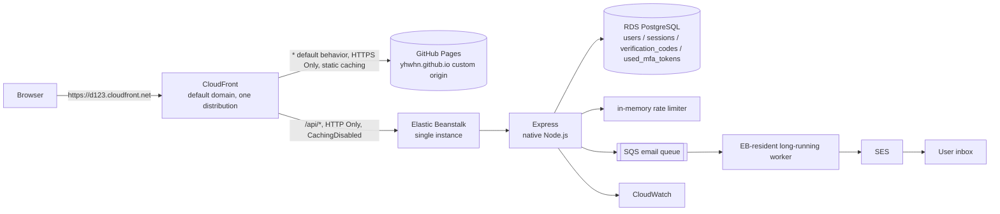

# Design: Veriflow Authentication Service on AWS

Veriflow is a self-managed authentication service: registration, email verification, session handling, password reset, and optional email-code MFA are implemented directly against a relational database. All paths in this document are relative to the repository root.

## Table of contents

1. [Purpose and scope](#1-purpose-and-scope)
2. [Goals and non-goals](#2-goals-and-non-goals)
3. [Constraints](#3-constraints)
4. [Scope](#4-scope)
5. [User flows](#5-user-flows)
6. [Technical architecture](#6-technical-architecture)
7. [PostgreSQL data model](#7-postgresql-data-model)
8. [API design](#8-api-design)
9. [Sessions and security](#9-sessions-and-security)
10. [Email and asynchronous delivery](#10-email-and-asynchronous-delivery)
11. [Frontend](#11-frontend)
12. [Acceptance criteria](#12-acceptance-criteria)
13. [Test plan](#13-test-plan)
14. [Deployment and operations](#14-deployment-and-operations)
15. [Cost estimate](#15-cost-estimate)
16. [Risks and current characteristics](#16-risks-and-current-characteristics)
17. [Left to the implementer](#17-left-to-the-implementer)
- [Appendix A: AWS service map](#appendix-a-aws-service-map)
- [Appendix B: MFA, 2FA, and the reference implementation](#appendix-b-mfa-2fa-and-the-reference-implementation)
- [Appendix C: Glossary](#appendix-c-glossary)

---

## 1. Purpose and scope

### 1.1 What this project is

A small "login-first" website:

- A visitor can register, verify their email, sign in, sign out, and reset a forgotten password.
- After sign-in there is a minimal `/app` placeholder page.
- Registration and password reset are completed with a 6-digit code sent by email.
- A user can enable email-code MFA in settings; it is off by default.
- Login, registration, code sending, and MFA verification are rate limited. Repeated password or MFA failures trigger a short account lockout.

The project covers the account lifecycle and nothing more. It is not an employee management system and not a blog.

### 1.2 Audience

- People who want to register and sign in to the site.
- People who want to read the code and the deployment story.
- Engineers reviewing whether the author understands authentication in a cloud deployment.

---

## 2. Goals and non-goals

### 2.1 Goals

- Complete the loop: register -> verify email -> sign in -> session -> sign out -> reset password.
- Support optional email-code MFA, off by default.
- Rate limit login, registration, code sending, and MFA verification; lock accounts after repeated password or MFA failures.
- Deploy on AWS using CloudFront, GitHub Pages, Elastic Beanstalk, RDS PostgreSQL, SQS, SES, SSM Parameter Store, CloudWatch, IAM, and CDK.
- Serve frontend and API from the same origin (CloudFront is the browser's only entry point and routes `/api/*` to the Elastic Beanstalk origin), so cookies never need to be cross-site.
- Provide automated tests, CDK deployment, GitHub Actions CI/CD, basic alarms, and cost alarm visibility.
- Implement authentication by hand, with no Cognito.

### 2.2 Non-goals

- The content of the blog or project description itself.
- An admin console, user management, or an audit-log query page.
- Third-party sign-in (Google/GitHub), passkeys, or TOTP.
- Multi-region, high availability, disaster-recovery drills, or load testing to very high concurrency.
- A complete WAF or anti-fraud system; application-level rate limiting and lockout are the defenses.
- A custom email template system; email is plain text.
- Copying the reference project `Two_Factor_Auth` as-is.

### 2.3 Anti-goals (reaching any of these is a failure)

- Passwords, verification codes, or session tokens stored or logged in plaintext.
- String-concatenated SQL instead of parameterized queries.
- An IAM policy containing `*`.
- Putting a JWT in `localStorage`.
- Splitting the system into microservices when the split cannot be justified.
- Deploying without cost alarm visibility and losing control of the monthly bill.

---

## 3. Constraints

- Project name: **Veriflow**. Region: `ap-southeast-1`. Only the `dev` environment exists.
- Frontend: Vite + React 18 (JavaScript, no TypeScript), React Router, Tailwind CSS, react-hook-form, and zod schemas shared through `packages/schemas`; no UI component library.
- Backend: native Express on a single-instance Elastic Beanstalk Node.js platform.
- Database: RDS PostgreSQL single-AZ, native `pg` driver with parameterized SQL only.
- Email: SES, fronted by an SQS queue and an Elastic Beanstalk-resident long-running worker.
- Infrastructure: AWS CDK (TypeScript, confined to `infra/`).
- Static hosting: the GitHub Pages user site `yhwhn.github.io`, used as a CloudFront custom origin.
- Public entry point: the CloudFront default domain (for example `https://d123.cloudfront.net`). There is no custom domain, ACM certificate, or Route 53 hosted zone.
- Authentication is implemented by hand; no Cognito.
- Cost: roughly $20–30/month of fixed hourly charges for the running EC2 and RDS instances, with no hard cap. Cost alarm visibility is configured. Billing is per running hour, not per request.
- Verification code rules: 6 digits, valid for 10 minutes, at most 5 attempts, 60-second resend cooldown, single use.
- Password: argon2id; minimum 8 / maximum 72 **bytes**, validated by byte length; passwords are not trimmed.
- Session: 7 days; `__Host-app_session` with `HttpOnly; Secure; SameSite=Lax; Path=/; Max-Age=604800`; the database stores only the SHA-256 of the token.
- MFA: optional, off by default; email codes only; no TOTP and no recovery codes.
- WAF is not part of the deployment. There is no prod environment suite and no high-availability or multi-region setup.

---

## 4. Scope

### 4.1 In scope

- Registration (email + password) with a 6-digit verification code.
- Email verification; an unverified email cannot sign in.
- Login (email + password).
- Optional email-code MFA: enable or disable in settings; when enabled, login takes one extra code step.
- Logout.
- Staying signed in across page reloads (7-day session).
- Forgot password and password reset (6-digit email code).
- A resend-verification page at `/resend-verification`.
- `/app` placeholder page plus route guard.
- Rate limiting for login, registration, code sending, and MFA.
- Lockout for 15 minutes after 5 password failures; 15 minutes after 10 MFA failures.
- AWS deployment: CloudFront, GitHub Pages, Elastic Beanstalk, RDS PostgreSQL, SQS, SES, SSM Parameter Store, CloudWatch, IAM, and CDK.
- GitHub Actions: test, build, CDK synth/deploy, frontend release.
- Baseline alarms: API 5xx, DLQ depth, SES bounces, RDS metrics, and cost alarm visibility.

### 4.2 Out of scope

- Blog or project description content.
- Admin console, user list, audit-log queries.
- Third-party sign-in, passkeys, TOTP, SMS.
- Multi-region, high availability, disaster-recovery drills.
- WAF, CAPTCHA images, device fingerprinting, risk scoring.
- Custom email templates and open-rate tracking.
- MFA recovery codes; a lost mailbox is handled manually by an operator.
- A public landing page (undecided; see §16.1).

### 4.3 Security baseline (non-negotiable)

- Hash passwords with argon2id; never store plaintext.
- Store verification codes only as HMAC-SHA256; never store plaintext and never return the code to the client.
- Store only the SHA-256 of session tokens; the cookie is `HttpOnly`/`Secure`/`SameSite=Lax`.
- Use uniform wording for login failures; do not reveal whether an email exists.
- Use only parameterized SQL against PostgreSQL; never concatenate values into a statement.
- Apply least-privilege IAM; keep secrets in EB environment properties or SSM Parameter Store.
- Never log passwords, verification codes, cookies, or complete tokens.
- On every write endpoint, validate `Content-Type: application/json` and the `Origin` header (same origin).

---

## 5. User flows

### 5.1 Registration and email verification

1. The user opens `/register` and enters email, password, and password confirmation.
2. The frontend validates format and length, then submits `POST /api/auth/register`.
3. The server normalizes the email (trim + lowercase).
4. The server checks whether the user already exists in `users`:
   - Exists: return `409 EMAIL_ALREADY_REGISTERED`; the page suggests "If this is your address, sign in or resend the verification email".
   - Does not exist: hash the password with argon2id; insert the `users` row (`email_verified_at` absent); generate a 6-digit code; insert a `verification_codes` row; enqueue an email job in SQS.
5. Return `201`. The frontend navigates to `/verify-email?email=...`.
6. The user receives the email and enters the 6-digit code, submitting `POST /api/auth/verify-email`.
7. The server loads the newest code, verifies the hash, expiry, attempt count, and purpose; on success it sets `email_verified_at` and marks the code consumed.
8. Return `200`; the frontend navigates to `/login` and reports that the email is verified.

**Failure handling:**

- Wrong code: `400 INVALID_CODE`; the remaining attempt count is not disclosed, only "the code is incorrect or has expired".
- Expired code: same as above.
- Resend: `POST /api/auth/resend-verification`; 60-second cooldown per email, at most 3 sends in 15 minutes; always returns `200` without revealing whether the email exists. If the account is already verified (`email_verified_at` present), it still returns `200` but sends no new code, changes no verification state, and does not reveal whether the account is verified.
- Queue failure: the registration endpoint returns `503 EMAIL_QUEUE_UNAVAILABLE`; the user can resend later. The user row already exists, so resending does not require registering again.

### 5.2 Login

1. The user opens `/login` and enters email and password.
2. The frontend submits `POST /api/auth/login`.
3. The server:
   - Loads the user by email; when the user does not exist, performs one comparison against a fixed dummy argon2id hash to avoid a timing difference.
   - Checks `locked_until`; if still locked, returns `423 ACCOUNT_LOCKED` with `Retry-After`.
   - Verifies the password; on failure increments `failed_login_count`, and at 5 failures sets `locked_until = now + 15min`, returning `401 INVALID_CREDENTIALS`.
   - If the password is correct but the email is unverified: return `403 EMAIL_NOT_VERIFIED`; the frontend points the user to verification or resend.
   - If the password is correct and `mfa_enabled = false`: create a session, set the cookie, return `200 { user }`.
   - If the password is correct and `mfa_enabled = true`: generate a 6-digit code (purpose `mfa_login`), issue an `mfaToken` (HMAC, 10 minutes), and return `200 { mfaRequired: true, mfaToken }` **without setting a session cookie**.
4. The frontend keeps `mfaToken` in memory (React state) and navigates to `/mfa`.
5. The user enters the email code and submits `POST /api/auth/mfa/verify` with `mfaToken` and `code` in the body.
6. The server verifies the signature and expiry, loads the user, checks that `session_version` matches the token, checks lockout, loads the newest code, and verifies it; on success it creates a session, sets the cookie, and returns `200 { user }`.
7. On failure: `401 INVALID_CODE`; the code's `attempts` is incremented; after 5 attempts that code is void; `failed_mfa_count` is incremented; at 10 failures the account is locked for 15 minutes and the response is `423`.

**Resending the MFA code:** `POST /api/auth/mfa/resend` with `mfaToken` in the body; 60-second cooldown; at most 3 sends per account in 15 minutes; returns `200` without returning a new code.

### 5.3 Session restore on page reload

1. On startup, `AuthProvider` calls `GET /api/auth/me`.
2. The server reads the cookie, hashes it with SHA-256, and loads the `sessions` row; missing or expired -> `401`.
3. The server loads `users` and compares `session_version`; a mismatch deletes the session and returns `401`.
4. The server returns `{ user }`; the frontend renders `/app`.
5. On any `401` from `/api/*`, the frontend clears the user, navigates to `/login`, and carries the current path as `from`.

### 5.4 Logout

1. `POST /api/auth/logout`.
2. The server deletes the `sessions` row, clears the cookie, and returns `204`.
3. The frontend clears the user and navigates to `/login`.

### 5.5 Forgot password and password reset

1. `/forgot-password` accepts an email; `POST /api/auth/forgot-password`.
2. Whether or not the email exists, return `200`; when it exists, generate a `reset_password` code and enqueue the email.
3. `/reset-password?email=...` accepts the 6-digit code and a new password; `POST /api/auth/reset-password`.
4. The server verifies the code; on success it:
   - updates `password_hash`
   - increments `session_version` (invalidating every old session)
   - clears `failed_login_count`, `failed_mfa_count`, and `locked_until`
   - marks the code consumed
5. Return `200`; the frontend navigates to `/login`.
6. An unverified email may still reset its password, but login afterwards is still blocked by `EMAIL_NOT_VERIFIED`; the frontend tells the user to verify the email first.

### 5.6 MFA settings

**Enabling:**

1. In `/app/settings`, click "Enable email codes".
2. Enter the current password; `POST /api/auth/mfa/enable`.
3. The server verifies the password, generates an `enable_mfa` code, enqueues the email, and returns `202`.
4. Enter the code; `POST /api/auth/mfa/enable/confirm`.
5. On success set `mfa_enabled = true`, clear `failed_mfa_count`, and return `200`.

**Disabling:**

1. Click "Disable email codes".
2. Enter the current password; `POST /api/auth/mfa/disable`.
3. The server verifies the password, generates a `disable_mfa` code, enqueues the email, and returns `202`.
4. Enter the code; `POST /api/auth/mfa/disable/confirm` (body contains password + code).
5. On success set `mfa_enabled = false`, clear `failed_mfa_count`, and return `200`.

**Rules:**

- Both directions require the current password; enabling also requires one email code, and disabling requires a fresh email code.
- No recovery codes; a lost mailbox is handled manually by an operator through the AWS console or the database directly (there is no admin UI).
- Toggling MFA does not force other sessions out. Signing out all devices after disabling MFA is done by incrementing `session_version`.

### 5.7 Route guards

- Public routes: `/login`, `/register`, `/verify-email`, `/resend-verification`, `/forgot-password`, `/reset-password`, `/mfa`.
- Protected routes: `/app`, `/app/settings`.
- `/`: redirects with `Navigate to="/app"`; if a public landing page is added, this becomes the public landing page (see §16.1).
- `RequireAuth` shows a skeleton while `loading`; when unauthenticated it renders `<Navigate to="/login" state={{ from: location }} />`; after sign-in the user is returned to `from`, accepting only in-app paths.

### 5.8 User experience under rate limiting and lockout

- `429`: show "Too many attempts, please try again later" with the `Retry-After` seconds; run a countdown on the button.
- `423`: show "Too many attempts, please try again in 15 minutes"; do not say whether the password or MFA triggered it.
- A wrong code never shows the remaining attempts; only the uniform error is displayed.

---

## 6. Technical architecture

### 6.1 Stack

| Layer | Choice | Notes |
|---|---|---|
| Build | Vite | Dev server + HMR + production bundle; locally proxies `/api` to `localhost:3001` |
| View | React 18 (JavaScript) | Browser UI runtime; no frontend TypeScript |
| Routing | React Router | Client-side routing + `RequireAuth` guard |
| Forms | react-hook-form | Form state and controlled inputs; not a UI component library |
| Validation | zod | Runtime schemas shared with the API through `packages/schemas` |
| Styling | Tailwind CSS | Atomic CSS; `@tailwind` entry in `web/src/index.css` |
| Global state | React Context (`AuthProvider`) | Only global auth state (`user` / `loading` / 401 navigation) |
| HTTP | Native `fetch` wrapped in `lib/api.js` | Uniform error parsing and 401 interception |
| Frontend hosting | GitHub Pages user site `yhwhn.github.io` | Used as a CloudFront custom origin for the default `*` cache behavior |
| Public entry point | One CloudFront distribution, default domain | Path-based routing; browser's only entry point |
| API compute | Elastic Beanstalk single-instance Node.js | Native Express; no load balancer, no TLS on the EB origin |
| Database | RDS PostgreSQL single-AZ | Native `pg` driver + SQL, parameterized queries only |
| Rate limiting | In-memory counters | Keyed by action / action+IP / action+email per fixed window |
| Email | SES + SQS + EB-resident worker | Asynchronous, retryable, with a DLQ |
| Secrets/config | EB environment properties / SSM Parameter Store | Loaded once at process start |
| Logs/metrics | CloudWatch | Structured logs, alarms, 14-day retention |
| IaC | AWS CDK (TypeScript) | `infra/` only; four stacks |
| CI/CD | GitHub Actions + OIDC | No long-lived AWS keys; frontend build published to GitHub Pages |
| Local DB | PostgreSQL 16 via Docker | Schema initialized by `npm run db:local` |

No UI component library, Redux/Zustand, or CSS preprocessor is used. The global state is limited to "signed in or not, current user, loading, and navigation on any 401", all derived from one `GET /api/auth/me` call and the login result, so a single Context is sufficient; form field state, validation, and error display stay local to each page through react-hook-form. The shared zod package exists so the frontend form rules and the API validation rules are the same set, avoiding drift between two workspace packages.

### 6.2 Request path



- The browser's only entry point is the CloudFront default domain, for example `https://d123.cloudfront.net`. There is no custom domain, ACM certificate, or Route 53 hosted zone.
- The default `*` cache behavior forwards to the GitHub Pages user site as a custom origin over HTTPS Only, with static caching.
- The `/api/*` cache behavior forwards to the Elastic Beanstalk single-instance origin over HTTP only, with the `CachingDisabled` policy; it forwards the `Cookie` and `Origin` headers. There is no load balancer and no TLS on the EB instance.
- A CloudFront Response Headers Policy is attached per cache behavior and adds `Content-Security-Policy`, `Strict-Transport-Security`, and `X-Content-Type-Options: nosniff`.
- CloudFront custom error pages map 403 and 404 to `/index.html` with response status 200, providing SPA fallback. Client-side routes such as `/login` and `/app` therefore open directly; the React build uses no special base path and the router has no basename.
- The same origin is preserved for frontend and API, so the `__Host-app_session` cookie is `HttpOnly; Secure; SameSite=Lax; Path=/; Max-Age=604800` and no CORS is configured. POST endpoints still validate `Origin` against the configured application base URL, with a development-origin allowlist.
- `Set-Cookie` passes through on `/api/*` and is never cached.

### 6.3 Repository layout

```text
login-app/
  package.json                 # npm workspaces root: web / api / infra / packages/schemas
  README.md
  .env.example                 # APP_BASE_URL, database, SES/SQS settings
  .gitignore
  packages/
    schemas/
      package.json
      src/index.js             # zod schemas (register / login / codes / reset / MFA)
  web/
    index.html
    vite.config.js             # /api proxy to localhost:3001, changeOrigin:false; build outputs dist
    tailwind.config.js
    postcss.config.js
    src/
      main.jsx                 # mounts <AuthProvider><App/></AuthProvider>
      App.jsx                  # composes the Router
      router.jsx               # public / protected route table
      index.css                # @tailwind entry
      lib/
        api.js                 # fetch wrapper: uniform errors, 401 interception
        constants.js           # route paths, error codes
      auth/
        AuthProvider.jsx       # Context: user / loading / refresh / logout
        useAuth.js             # hook consuming the Context
        RequireAuth.jsx        # route guard
      components/
        AuthCard.jsx           # centered narrow card container
        TextField.jsx          # label/error-bound text input
        PasswordField.jsx      # password input with show/hide
        Button.jsx             # submit button (loading/disabled)
        Alert.jsx              # role="alert" message bar
        Spinner.jsx            # loading indicator
      pages/
        Login.jsx
        Register.jsx
        VerifyEmail.jsx
        ResendVerification.jsx
        ForgotPassword.jsx
        ResetPassword.jsx
        MfaVerify.jsx
        AppHome.jsx
        Settings.jsx
        NotFound.jsx
  api/
    package.json
    src/
      app.js                   # Express app (express.json({limit:'20kb'}))
      server.js                # local listen on :3001
      worker.js                # long-running SQS consumer -> SES
      config.js                # reads env / SSM parameters at process start
      validation/
        schemas.js             # re-exports packages/schemas
      db/
        client.js              # pg Pool
        users.js
        sessions.js
        codes.js
        usedMfaTokens.js
      services/
        authService.js
        codeService.js
        emailService.js
        rateLimitService.js
        lockoutService.js
        tokenService.js
      middleware/
        auth.js
        rateLimit.js
        errors.js
      routes/
        auth.js
        mfa.js
        health.js
      emails/
        templates.js
    test/
  infra/
    bin/app.ts
    lib/
      data-stack.ts
      api-stack.ts
      web-stack.ts
      observability-stack.ts
    cdk.json
    package.json
  tests/
    e2e/
    load/
  docs/
    design.md
```

### 6.4 Local development

```bash
# 1. PostgreSQL 16
docker run -d -p 5432:5432 -e POSTGRES_PASSWORD=dev postgres:16

# 2. Install
npm install

# 3. Initialize the PostgreSQL schema
npm run db:local

# 4. Start web + api
npm run dev
```

- `web`: Vite on `http://localhost:5173`, proxying `/api` to `http://localhost:3001` with `changeOrigin:false`.
- `api`: Express on `http://localhost:3001`.
- `EMAIL_DRIVER=console`: verification codes are printed in the API terminal; SQS and SES are not contacted.
- The frontend calls relative `/api/*` only; no absolute API domain is baked into the build and no `VITE_API_BASE_URL` is used.
- CloudFront, the Elastic Beanstalk environment, and the EB-resident worker are not run locally; the Vite proxy emulates the same-origin setup.

### 6.5 Configuration and secrets

`.env.example`:

```dotenv
PORT=3001
APP_BASE_URL=http://localhost:5173
PGHOST=localhost
PGPORT=5432
PGUSER=dev
PGPASSWORD=dev
PGDATABASE=veriflow
EMAIL_DRIVER=console
SES_FROM=no-reply@example.com
SQS_QUEUE_URL=
CODE_SECRET=dev-only-not-for-production
MFA_TOKEN_SECRET=dev-only-not-for-production
```

- `APP_BASE_URL` is the configured application base URL used for `Origin` validation.
- `CODE_SECRET` and `MFA_TOKEN_SECRET` are the HMAC keys. The local values above are development-only; deployment supplies real values.
- Deployed configuration lives in Elastic Beanstalk environment properties and SSM Parameter Store, loaded once at process start. Database connection settings, the SQS queue URL, SES sender, and the HMAC keys are all supplied this way.
- `.env` is not committed; `.env.example` holds placeholders only.

### 6.6 CDK stacks

| Stack | Resources |
|---|---|
| `DataStack` | RDS PostgreSQL single-AZ instance, database and credentials, automated snapshots |
| `ApiStack` | Elastic Beanstalk application and single-instance Node.js environment, SQS + DLQ, the resident email worker process, IAM instance profile, logs, alarms |
| `WebStack` | One CloudFront distribution with two origins and two cache behaviors, the Response Headers Policy, and custom error pages |
| `ObservabilityStack` | Dashboard, alarms, and cost alarm visibility |

- `WebStack` maps CloudFront 403/404 to `/index.html` with status 200 (SPA fallback), so opening `/login` or `/app` directly does not 404.
- The default `*` cache behavior targets the GitHub Pages user site over HTTPS Only with static caching. The `/api/*` cache behavior targets the EB origin over HTTP only with the `CachingDisabled` policy and forwards the `Cookie` and `Origin` headers.
- The Response Headers Policy is attached per cache behavior and adds `Content-Security-Policy`, `Strict-Transport-Security`, and `X-Content-Type-Options: nosniff`.
- `ApiStack` depends on `DataStack` for the database connection information; `WebStack` points its `/api/*` origin at the Elastic Beanstalk environment.
- Only the `dev` environment is defined; resource names carry the `dev` suffix. The region is `ap-southeast-1` and the deployment is single-region.

### 6.7 CI/CD

- `ci.yml`: `npm ci` -> lint -> unit/integration -> `npm run build` -> `cdk synth`.
- `deploy.yml`: manual trigger or push to `main`; assumes a role through GitHub OIDC; `cdk deploy --all`.
- The frontend build (`web/dist`) is published to the GitHub Pages user site, which CloudFront serves as the default `*` origin. Static assets are content-hashed and `index.html` is not cached.
- GitHub OIDC: the IAM role trusts `token.actions.githubusercontent.com` and is restricted by repository and branch; no long-lived access keys.
- Only the `dev` environment is deployed.

### 6.8 Observability

- Express structured logs: `requestId`, route, status, duration, `userId` (optional); never passwords, codes, or cookies.
- CloudWatch alarms: API 5xx, SQS `ApproximateNumberOfMessagesVisible` / DLQ > 0, SES `Bounce`/`Complaint`, RDS instance metrics, and cost alarm visibility.
- Alarms publish to SNS -> email; there is no paging integration.
- Log retention is 14 days.
- CloudWatch metrics cover the EB instance, RDS, CloudFront, SQS, and SES.

### 6.9 Development configuration constraints

- **Email normalization is centralized.** A single `normalizeEmail()` (trim + lowercase) is applied at the request entry, before the value is used as any database key or rate-limit key. The same normalized value is used for register, login, forgot-password, reset-password, resend, and verify. Without this, one address would be treated as two accounts.
- **Development `Origin` allowlist.** Production write endpoints validate `Origin` against the configured application base URL. Local development runs the frontend on `:5173` and the API on `:3001`, so the browser `Origin` differs from the API port. The `Origin` middleware recognizes the development environment (from `APP_ENV` / CDK context) and includes the browser origin in the same-origin allowlist; the Vite proxy forwards server-to-server and its forwarded `Origin` follows the same rule. Without this, all local write endpoints would reject their own requests.
- **SES sandbox silent failure.** In the SES sandbox, a message to an unverified recipient returns success but is never delivered. Registration and password-reset endpoints still return their normal success responses while the account remains unreachable. A verified sending domain with DKIM and SES production access are prerequisites for a working deployment, confirmed in the runbook and acceptance checks rather than treated as an ordinary 200.
- **Password byte length.** Frontend and backend validation both measure byte length with `TextEncoder` (available in both the browser and Node.js), not JavaScript `.length`: minimum 8 bytes, maximum 72 bytes. This avoids mis-measuring multi-byte characters (Chinese, emoji) against the 72-byte upper bound.
- **Already-verified resend.** `/resend-verification` on an account with `email_verified_at` set returns `200`, sends no new code, does not change verification state, and does not reveal whether the account is verified.

---

## 7. PostgreSQL data model

### 7.1 Conventions

- Identifiers are `snake_case` for tables and columns.
- Data access uses the native `pg` driver with SQL and parameterized queries only; values are never concatenated into a statement.
- Time columns used for expiry (`expires_at`, `locked_until`) hold epoch seconds.
- Expired rows are handled by **read-time lazy deletion**: every read checks `expires_at` and treats an expired row as absent (deleting it on access). There is no background cleanup service.
- Unique constraints and conditional updates guard concurrent registration and single code consumption.
- Multi-row changes run inside a transaction; a read that must see a just-written row runs in the same transaction or immediately afterwards against the same primary key.

### 7.2 `users`

Primary key: `email`.

| Column | Type | Notes |
|---|---|---|
| `email` | text | PK; trimmed and lowercased |
| `user_id` | uuid | `crypto.randomUUID()` |
| `password_hash` | text | argon2id hash |
| `email_verified_at` | bigint | Epoch seconds; `NULL` when unverified |
| `mfa_enabled` | boolean | Defaults to false |
| `failed_login_count` | integer | Consecutive password failures |
| `failed_mfa_count` | integer | Consecutive MFA failures |
| `locked_until` | bigint | Epoch seconds; `NULL` when not locked |
| `session_version` | integer | Starts at 1; incremented on password reset |
| `created_at` | bigint | Epoch seconds |
| `updated_at` | bigint | Epoch seconds |

Access:

- Login, registration, and user lookup: `SELECT ... WHERE email = $1`.
- Create: `INSERT`; the primary key on `email` makes a concurrent duplicate fail with a unique violation, mapped to 409.
- Failure counting: `UPDATE users SET failed_login_count = failed_login_count + 1 ... RETURNING failed_login_count`; once the threshold is reached a follow-up statement sets `locked_until`.
- Password reset: a transaction updates `users` and consumes the verification code together.

User lookup is always by `email`; the `user_id` is exposed to the client as `user.id` but is not used as a lookup key.

### 7.3 `sessions`

Primary key: `token_hash`.

| Column | Type | Notes |
|---|---|---|
| `token_hash` | text | PK; SHA-256 hex of the raw cookie token |
| `user_email` | text | Used to load `users` |
| `session_version` | integer | Version at issue time |
| `expires_at` | bigint | Epoch seconds; checked on every read |
| `created_at` | bigint | Epoch seconds |

Access:

- Read a session: `SELECT ... WHERE token_hash = $1`, then check `expires_at` and compare `session_version` against `users`.
- Create: `INSERT`.
- Logout: `DELETE`.
- A password reset increments `session_version`; an old session is rejected with 401 and deleted on its next request. There is no "list all sessions for a user" query.

### 7.4 `verification_codes`

Primary key: `code_id`.

| Column | Type | Notes |
|---|---|---|
| `code_id` | uuid | PK |
| `scope` | text | `${email}#${purpose}` |
| `email` | text | Normalized recipient |
| `code_hash` | text | HMAC-SHA256(code) |
| `purpose` | text | `verify_email`, `reset_password`, `mfa_login`, `enable_mfa`, `disable_mfa` |
| `attempts` | integer | Attempts so far |
| `expires_at` | bigint | Epoch seconds; checked on every read |
| `consumed_at` | bigint | Epoch seconds; `NULL` when unused |
| `created_at` | bigint | Epoch seconds |

Access:

- Load the newest code with an indexed query: `SELECT ... WHERE scope = $1 ORDER BY created_at DESC, code_id DESC LIMIT 1`. Only the newest row is read; older rows are never queried and no bulk delete is needed.
- Create: `INSERT`; a new code becomes the newest and older ones are implicitly ignored.
- Consume: a conditional `UPDATE ... SET consumed_at = $1 WHERE code_id = $2 AND consumed_at IS NULL AND attempts < 5 AND expires_at > $3`; zero rows updated means the code is unusable.
- Failure: `UPDATE ... SET attempts = attempts + 1`; after 5 attempts the conditional consume can no longer succeed.
- Cooldown: the newest row's `created_at` is compared against the 60-second resend cooldown; a request inside the window returns 429.

### 7.5 `used_mfa_tokens`

Primary key: `token_hash`.

| Column | Type | Notes |
|---|---|---|
| `token_hash` | text | PK; SHA-256 of the presented `mfaToken` |
| `purpose` | text | `mfa_login` |
| `expires_at` | bigint | Epoch seconds; checked on every read |

This table tracks single-use `mfaToken` values: on successful verification the token hash is inserted with a unique constraint, so presenting the same token twice is rejected.

### 7.6 Access patterns

| Scenario | Operation | Table |
|---|---|---|
| Load user by email | `SELECT` on `email` | `users` |
| Create user | `INSERT` (unique `email`) | `users` |
| Count password failures | `UPDATE ... + 1 RETURNING` | `users` |
| Lock account | `UPDATE ... SET locked_until` | `users` |
| Reset password | transaction over `users` + `verification_codes` | `users`, `verification_codes` |
| Read session | `SELECT` on `token_hash` | `sessions` |
| Create or delete session | `INSERT` / `DELETE` | `sessions` |
| Load newest code | indexed `SELECT ... ORDER BY ... LIMIT 1` | `verification_codes` |
| Create code | `INSERT` | `verification_codes` |
| Consume code | conditional `UPDATE` | `verification_codes` |
| Record used MFA token | `INSERT` (unique `token_hash`) | `used_mfa_tokens` |
| Rate-limit counting | in-memory fixed-window counter | — |

### 7.7 Transactions and concurrency

- Registration: the unique constraint on `users.email` prevents concurrent duplicate registration; a unique violation is mapped to 409.
- Code consumption: the conditional `UPDATE` (with `consumed_at IS NULL`) prevents the same code from being used concurrently; exactly one competing request updates the row.
- Password failure counting: the increment is a single atomic `UPDATE ... RETURNING`; setting `locked_until` is a follow-up statement, so extreme concurrency may record an extra attempt or two, which is acceptable.
- Password reset: one transaction updates `users` (`password_hash`, `session_version`, lockout fields) and consumes the code, preventing "password changed but code still usable".
- Email verification consumes the code and sets `email_verified_at` in the same transaction.
- MFA token single-use: the unique constraint on `used_mfa_tokens.token_hash` prevents concurrent reuse of one token.
- Rate-limit counters live in process memory on the single EB instance; they are not shared across processes and are not persisted.

### 7.8 Expiry handling

- Expired rows are not removed by a background job. Every read checks `expires_at` and treats an expired row as absent; the row is deleted on access (read-time lazy deletion).
- An expired code may still be returned by the newest-row query; validation first requires `expires_at > now` and `consumed_at IS NULL`.
- An expired session may still be returned by its primary key lookup; validation checks `expires_at` before accepting it.
- An expired `used_mfa_tokens` row is treated as absent, so the same token cannot be replayed inside its validity window.

---

## 8. API design

### 8.1 Conventions

- Base path: `/api`.
- JSON: requests use `Content-Type: application/json`; responses are `application/json`.
- Authentication: the `HttpOnly` cookie `__Host-app_session`; MFA login uses `mfaToken` in the body, not a cookie.
- Error shape:
  ```json
  { "error": { "code": "INVALID_CREDENTIALS", "message": "Incorrect email or password" } }
  ```
- `429` and `423` responses include a `Retry-After` header.
- Every POST validates that `Origin` matches the configured application base URL (with a development-origin allowlist); a mismatch returns 403.
- GET is never used for state changes.
- The frontend calls relative `/api/*` only; no absolute API domain is baked into the build.

### 8.2 Endpoints

| Method | Path | Authentication | Success | Main errors |
|---|---|---|---|---|
| POST | `/api/auth/register` | None | 201 | 400, 409, 429, 503 |
| POST | `/api/auth/verify-email` | None | 200 | 400, 429 |
| POST | `/api/auth/resend-verification` | None | 200 | 400, 429 |
| POST | `/api/auth/login` | None | 200 (user or MFA challenge) | 401, 403, 423, 429 |
| POST | `/api/auth/mfa/verify` | `mfaToken` | 200 | 401, 423, 429 |
| POST | `/api/auth/mfa/resend` | `mfaToken` | 200 | 401, 429 |
| POST | `/api/auth/logout` | Cookie | 204 | 401 |
| GET | `/api/auth/me` | Cookie | 200 | 401 |
| POST | `/api/auth/forgot-password` | None | 200 | 429 |
| POST | `/api/auth/reset-password` | None | 200 | 400, 429 |
| POST | `/api/auth/mfa/enable` | Cookie | 202 | 401, 409, 429 |
| POST | `/api/auth/mfa/enable/confirm` | Cookie | 200 | 400, 401, 429 |
| POST | `/api/auth/mfa/disable` | Cookie | 202 | 401, 429 |
| POST | `/api/auth/mfa/disable/confirm` | Cookie | 200 | 400, 401, 429 |
| GET | `/api/health` | None | 200 | - |

### 8.3 Key requests and responses

**Register:**

```json
POST /api/auth/register
{ "email": "a@example.com", "password": "correct horse battery staple" }
-> 201 { "message": "Verification code sent" }
```

**Login without MFA:**

```json
POST /api/auth/login
{ "email": "a@example.com", "password": "..." }
-> 200 { "user": { "id": "...", "email": "a@example.com", "mfaEnabled": false } }
Set-Cookie: __Host-app_session=...; HttpOnly; Secure; SameSite=Lax; Path=/; Max-Age=604800
```

**Login with MFA:**

```json
-> 200 {
  "mfaRequired": true,
  "mfaToken": "<base64url payload>.<base64url signature>"
}
```

**MFA verification:**

```json
POST /api/auth/mfa/verify
{ "mfaToken": "...", "code": "123456" }
-> 200 { "user": { ... } }
Set-Cookie: __Host-app_session=...; HttpOnly; Secure; SameSite=Lax; Path=/; Max-Age=604800
```

**Password reset:**

```json
POST /api/auth/reset-password
{ "email": "a@example.com", "code": "123456", "newPassword": "..." }
-> 200 { "message": "Password reset" }
```

**Health:**

```json
GET /api/health
-> 200 { "status": "ok" }
```

### 8.4 The `mfaToken`

It is not persisted as a challenge; it is HMAC-signed:

```text
payload = base64url(JSON.stringify({
  sub: user_id,
  email,
  sv: session_version,
  purpose: "mfa_login",
  iat,
  exp: iat + 600
}))
signature = base64url(HMAC-SHA256(payload, MFA_TOKEN_SECRET))
mfaToken = payload + "." + signature
```

Validation:

- Compare the signature with `crypto.timingSafeEqual`.
- `exp` is in the future and `purpose` is correct.
- Load the user; require `user.session_version === sv`, otherwise 401 (a password reset invalidates old tokens).
- Require `user.mfa_enabled` to still be true, otherwise 401.
- Require the user not to be locked.

There is no `mfa_challenges` table. A password reset invalidates outstanding tokens automatically. Each `mfaToken` is single-use: on successful verification its hash is recorded in `used_mfa_tokens`. An issued token expires in 10 minutes.

### 8.5 Validation rules

- Requests are JSON with `Content-Type: application/json`; a missing or different content type is rejected on write endpoints.
- Email is normalized once at the request entry with `normalizeEmail()` (trim + lowercase) and must be a valid email address.
- Password is 8–72 bytes by byte length, is not trimmed, and allows any characters; `newPassword` follows the same rule.
- `code` is exactly 6 digits.
- `mfaToken` is the signed `base64url(payload).base64url(signature)` string.
- Server-side validation is authoritative; the shared zod schemas in `packages/schemas` express the same rules for frontend forms (wired through `@hookform/resolvers/zod`). Frontend validation covers format, length, and confirmation only; errors are displayed from the server response codes.
- The `user` object is `{ id, email, mfaEnabled }`, where `id` is `users.user_id` and `mfaEnabled` is `users.mfa_enabled`.

### 8.6 Error codes

| Code | HTTP | Meaning |
|---|---|---|
| `VALIDATION_ERROR` | 400 | Missing field or invalid format |
| `INVALID_CREDENTIALS` | 401 | Wrong email or password |
| `EMAIL_NOT_VERIFIED` | 403 | Email not verified |
| `EMAIL_ALREADY_REGISTERED` | 409 | Duplicate registration |
| `INVALID_CODE` | 400 | Code wrong, expired, or already used |
| `CODE_COOLDOWN` | 429 | Code requested again within 60 seconds |
| `RATE_LIMITED` | 429 | Rate limit exceeded |
| `ACCOUNT_LOCKED` | 423 | Account locked |
| `MFA_ALREADY_ENABLED` | 409 | MFA already enabled |
| `MFA_NOT_ENABLED` | 409 | MFA not enabled |
| `EMAIL_QUEUE_UNAVAILABLE` | 503 | Enqueue failed |
| `INTERNAL_ERROR` | 500 | Unexpected error |

Public messages are uniform and short; responses never include stack traces, SQL or table names, or internal identifiers. `429`/`423` carry `Retry-After` in seconds and the frontend uses it for a button countdown. `POST /api/auth/logout` returns 204; `GET /api/auth/me` returns 401 when signed out.

---

## 9. Sessions and security

### 9.1 Session cookie

- Name: `__Host-app_session` (the `__Host-` prefix requires `Secure`, no `Domain` attribute, and HTTPS; it is defense-in-depth on top of `SameSite=Lax`).
- Value: 32 random bytes, base64url; it appears only in the cookie, and the database stores its SHA-256.
- Attributes: `HttpOnly; Secure; SameSite=Lax; Path=/; Max-Age=604800`.
- HTTPS is provided by CloudFront; local HTTP omits `Secure`, decided by environment.
- No sliding renewal; the session expires after 7 days and the user signs in again.
- Logout deletes the `sessions` row and clears the cookie.
- Password reset increments `session_version`; old sessions are rejected and deleted on their next request.
- **Session fixation defense:** on successful sign-in and whenever `session_version` changes, the server issues a brand-new `token_hash` session cookie and invalidates the prior token on the server. It never reuses any pre-login session, including an anonymous pre-set cookie.

### 9.2 Passwords

- argon2id; asynchronous `hash`/`compare`.
- Minimum 8 / maximum 72 bytes, validated by byte length (`new TextEncoder().encode(value).length`, not `.length`); passwords are not trimmed; no restriction on special characters.
- Validated on both registration and reset.
- On login, a missing email still triggers one comparison against a dummy argon2id hash to reduce the timing difference.
- The API never distinguishes "wrong password" from "email does not exist".

### 9.3 Verification codes

- 6 digits from `crypto.randomInt(0, 1_000_000)`, zero-padded.
- Only `HMAC-SHA256(code, CODE_SECRET)` is stored; never the plaintext.
- 10-minute expiry; 5 attempts; 60-second resend cooldown; single use.
- Comparison uses `timingSafeEqual`.
- Only the newest row for a `scope` is read; older rows are never queried and no bulk delete is needed.
- The email body contains only the code, never a link, to reduce phishing and scanner clicks.
- The code is never returned to the client, except through the console adapter in development.

### 9.4 Rate-limit matrix

| Action | Key | Limit | Window |
|---|---|---|---|
| Login | IP | 20 | 15 minutes |
| Registration | IP | 5 | 1 hour |
| Resend registration verification | Email | 3 | 15 minutes |
| Verify email submission | Email | 10 | 15 minutes |
| Verify email submission | IP | 30 | 15 minutes |
| Forgot password | Email | 3 | 15 minutes |
| Forgot password | IP | 10 | 1 hour |
| Reset password submission | IP | 10 | 15 minutes |
| MFA verification | IP | 30 | 15 minutes |
| MFA resend | Account | 3 | 15 minutes |
| MFA setup code | Account | 5 | 15 minutes |

- Counters are single-instance in-memory fixed-window counters keyed by action / action+IP / action+email.
- The IP comes from `req.ip`, or from `X-Forwarded-For` behind CloudFront; IP values are hashed in logs, so raw addresses are not written to logs.
- Exceeding a limit returns 429 with `Retry-After`; the exact remaining allowance is not disclosed.

### 9.5 Account lockout

- 5 consecutive password failures -> `locked_until = now + 15min`.
- 10 consecutive MFA failures -> `locked_until = now + 15min`.
- The two counters are separate; they share one `locked_until`.
- A successful login (password and MFA both passed) clears both counters.
- A password reset clears both counters and `locked_until`.
- While locked, responses are 423 with `Retry-After`; password and MFA lockouts are indistinguishable.
- A single MFA challenge is void after 5 wrong attempts; the user must sign in again to obtain a new `mfaToken`.
- Lockout is account-scoped, so an attacker can lock another account with wrong passwords (a denial-of-service). IP rate limiting, the short 15-minute window, and uniform messaging reduce the impact; this is an accepted risk.

### 9.6 CSRF and CORS

- Frontend and backend share an origin (CloudFront); CORS is not configured.
- The cookie is `SameSite=Lax`; cross-site POST requests do not carry it.
- Every write endpoint checks `Origin` against the configured application base URL; a mismatch returns 403.
- `Content-Type: application/json` is required; a simple cross-site form submission cannot set it.
- There is no CSRF token; the residual risk is recorded in §16.2.

### 9.7 Least-privilege IAM

The Elastic Beanstalk instance profile allows only:

- `sqs:SendMessage` (API), scoped to the email queue ARN.
- `sqs:ReceiveMessage`, `sqs:DeleteMessage`, `sqs:ChangeMessageVisibility` (worker).
- `ses:SendEmail` (worker only).
- `ssm:GetParameter`, `ssm:GetParameters` (specific parameter ARNs).
- `logs:CreateLogStream`, `logs:PutLogEvents`.
- CloudWatch metrics publication.

### 9.8 Logging and privacy

- Structured JSON: `level`, `msg`, `requestId`, `route`, `status`, `durationMs`, `userId` (optional).
- Never logged: passwords, verification codes, cookies, `Authorization`, complete `mfaToken` values, SES message bodies.
- Error logs may carry internal error codes; clients receive only uniform messages.
- CloudWatch retention is 14 days.
- IP addresses appear only as hashes; User-Agent is truncated.

### 9.9 Other security trade-offs

- A 409 on registration reveals that an email is registered; this is a usability trade-off. Login and forgot-password do not reveal it.
- A 423 on lockout reveals that an account exists; IP rate limiting and uniform messaging reduce the signal.
- WAF is not part of the deployment. Application rate limits and lockout are the defenses.
- There is no audit table; security events rely on CloudWatch logs and alarms.
- The Elastic Beanstalk origin is reachable through its own endpoint. CloudFront is the canonical entry point; direct access to the EB endpoint is accepted.

---

## 10. Email and asynchronous delivery

### 10.1 Flow

1. The API generates a code and inserts a `verification_codes` row.
2. The API sends an SQS message:
   ```json
   { "to": "a@example.com", "purpose": "verify_email", "code": "123456", "codeId": "..." }
   ```
3. The EB-resident long-running worker process consumes it:
   - validates the message fields;
   - calls SES `SendEmail` (plain text);
   - returns on success; on failure it throws, and SQS retries.
4. After 3 retries the message lands in the DLQ; a CloudWatch alarm notifies the operator.

### 10.2 Delivery characteristics

- Login and registration do not wait for SES; SES latency or errors do not affect API latency.
- Retries are automatic, and the DLQ preserves messages that exhausted their retries.
- Templates and bounce handling are isolated in the worker process.

### 10.3 Failure semantics

- Enqueue failure: the API returns `503 EMAIL_QUEUE_UNAVAILABLE`; the user row and code may already exist, and the user can retry through "resend".
- Enqueue succeeds but SES fails: the API still returns 201/200; the user receives no email, can resend, and the DLQ alarm tells the operator.
- Duplicate delivery: SQS is at-least-once, so a user may receive a duplicate email. At-least-once delivery is accepted; the worker can deduplicate on `codeId`.
- Local: `EMAIL_DRIVER=console` prints the code and does not contact SQS or SES.

### 10.4 SES configuration

- Verify the sending domain (or address); configure DKIM.
- Sandbox mode can only send to verified addresses; production access is requested before the service delivers mail to arbitrary recipients.
- Plain-text email; `From: no-reply@<domain>`; `Reply-To` may be empty.
- Bounces and complaints raise alarms only; addresses are not auto-suppressed.
- Sending quotas: SES has default rate and daily limits, which are sufficient at low traffic.

---

## 11. Frontend

### 11.1 Routes

```text
/                     -> Navigate to /app (or a public landing page, undecided)
/login                -> Login
/register             -> Register
/verify-email         -> VerifyEmail
/resend-verification  -> ResendVerification
/forgot-password      -> ForgotPassword
/reset-password       -> ResetPassword
/mfa                  -> MfaVerify (requires location.state.mfaToken)
/app                  -> RequireAuth -> AppHome
/app/settings         -> RequireAuth -> Settings
*                     -> NotFound
```

### 11.2 State

- `AuthProvider`: `user`, `loading`, `refresh()`, `logout()`.
- On startup it calls `GET /api/auth/me`; a 401 means unauthenticated.
- `login()` returns `{ user }` or `{ mfaRequired, mfaToken }`; in the latter case the Login page calls `navigate('/mfa', { state: { mfaToken } })`.
- `mfaToken` lives only in React state / `location.state`, **never in `localStorage` or `sessionStorage`**; if `/mfa` is refreshed the token is gone and the user returns to `/login`.
- On any API `401`, `AuthProvider` clears the user, navigates to `/login`, and carries `from`.
- The frontend never stores passwords, verification codes, or session tokens.
- Session re-issuance on successful sign-in is a backend behavior: the server issues a brand-new `token_hash` cookie on sign-in and whenever `session_version` changes, and invalidates the prior token. The frontend only calls `refresh()` to read `user` after the response; it never reuses a pre-login cookie.
- Global auth state is a single React Context because it is limited to "signed in or not, current user, loading, and navigation on any 401". Form field state, validation errors, and submitting state stay local to each page through react-hook-form, with rules from the shared `packages/schemas` zod schemas. Frontend validation covers format, length, and confirmation; the server is authoritative and the displayed error comes from the server response code.
- Errors are shown through the `Alert` component using the uniform `message` from `{ error: { code, message } }`; `429`/`423` read `Retry-After` seconds and disable the button with a countdown.

### 11.3 Pages

| Page | Contents |
|---|---|
| Login | Email, password, show/hide toggle, sign in, link to register, forgot password |
| Register | Email, password, confirm password, register, link to sign in |
| VerifyEmail | Email (read-only or editable), 6-digit code, verify, resend |
| ResendVerification | Email, resend; uniform message "If the address exists, a code has been sent" |
| ForgotPassword | Email, send; uniform message |
| ResetPassword | Email, code, new password, confirmation |
| MfaVerify | 6-digit code, verify, resend, back to sign in |
| AppHome | Placeholder: signed in successfully |
| Settings | MFA toggle; enable and disable flows; current password |

Component split:

| Component / file | Responsibility |
|---|---|
| `main.jsx` | Renders `<AuthProvider><App/></AuthProvider>` |
| `App.jsx` | Composes the routes from `router.jsx` |
| `router.jsx` | Route table: public (`/login`, etc.) and protected (`/app`, `/app/settings`) |
| `auth/AuthProvider.jsx` | Holds `{ user, loading }`; calls `GET /api/auth/me` on mount; exposes `refresh()` and `logout()`; any API 401 clears the user and navigates to `/login` with `from` |
| `auth/useAuth.js` | Hook reading the AuthContext; pages take `user` and call `logout()` through it |
| `auth/RequireAuth.jsx` | Guard: skeleton while `loading`; unauthenticated -> `<Navigate to="/login" state={{from}}>`; after sign-in returns to `from` (in-app paths only) |
| `lib/api.js` | `fetch` wrapper: relative `/api` base, parses `{error:{code,message}}`, forwards 401 to AuthProvider, reads `Retry-After` |
| `lib/constants.js` | Route paths and error-code strings |
| `components/AuthCard.jsx` | Centered narrow card container (max width, padding, background) |
| `components/TextField.jsx` | Text input with `label` binding, `aria-invalid`, error text, `autocomplete` |
| `components/PasswordField.jsx` | Password input with show/hide toggle |
| `components/Button.jsx` | Submit button: disabled + Spinner while `loading` |
| `components/Alert.jsx` | Error/info bar with `role="alert"` |
| `components/Spinner.jsx` | Loading indicator |
| `pages/Login.jsx` | Email + password form (react-hook-form + zod); submits `POST /api/auth/login`; on `mfaRequired` navigates to `/mfa` with `{state:{mfaToken}}` |
| `pages/Register.jsx` | Email + password + confirmation; submits registration; goes to `/verify-email?email=` |
| `pages/VerifyEmail.jsx` | 6-digit code input; submits verification; includes resend |
| `pages/ResendVerification.jsx` | Email input for resend; uniform message |
| `pages/ForgotPassword.jsx` | Email input; uniform message |
| `pages/ResetPassword.jsx` | Email + code + new password; submits reset |
| `pages/MfaVerify.jsx` | 6-digit code; submits `POST /api/auth/mfa/verify`, taking the token from `location.state.mfaToken`; a refresh that loses it returns to `/login` |
| `pages/AppHome.jsx` | Signed-in placeholder page |
| `pages/Settings.jsx` | MFA toggle; enable/disable flows (current password + email code) |
| `pages/NotFound.jsx` | 404 page |

### 11.4 Visual design

- Reference the light, narrow-column, quiet style of write.as; do not copy a dark login page.
- Tailwind CSS replaces a hand-written `styles.css`; `web/src/index.css` contains `@tailwind base/components/utilities`. `tailwind.config.js` scans `web/index.html` and `web/src/**/*.{js,jsx}` and defines the design tokens (colors, spacing, 640px narrow-column max width).
- Maximum width 640px; the login card is centered; serif is acceptable for prose, sans-serif for forms.
- Colors: near-black text, light gray background, one low-saturation accent; no gradients or glassmorphism.
- Responsive: single column on phones; full-width buttons.
- Accessibility: `label` bound to each input; errors use `role="alert"`; visible focus; loading/disabled button states; correct `autocomplete` values (email `email`, password `current-password`/`new-password`).
- Security response headers (`Content-Security-Policy`, `Strict-Transport-Security`, `X-Content-Type-Options: nosniff`) come from the CloudFront Response Headers Policy, not frontend code.

### 11.5 Public landing page (open question)

If the goal is promotion, a pure login gate leaves first-time visitors without an explanation. A suggested layout:

```text
[Logo / name]
One line: a small project demonstrating sign-in, email verification, and optional MFA.
[Sign in] [Register]
```

- `/` would be public; `/app` would remain protected.
- Whether `/` is a pure gate or this landing page is an open product decision (see §16.1).

---

## 12. Acceptance criteria

### 12.1 Local

- [ ] `npm run dev` starts web and api together against `postgres:16` initialized with `npm run db:local`.
- [ ] Register -> code visible in the console -> verify -> sign in -> `/app`.
- [ ] Signing in with an unverified email is blocked with 403.
- [ ] Duplicate registration returns 409; `/resend-verification` can resend.
- [ ] Forgot password -> console code -> reset -> old session gets 401 -> new password signs in.
- [ ] Enable MFA -> sign out -> login shows the MFA step -> entering the code completes sign-in.
- [ ] Disable MFA -> the next login goes straight through.
- [ ] Five wrong passwords -> 423; ten wrong MFA codes -> 423.
- [ ] Exceeding login/registration/code-send limits -> 429 with `Retry-After`.
- [ ] The cookie has `HttpOnly`/`SameSite=Lax`; the production build sets `Secure`.
- [ ] Any frontend 401 returns to the login page.
- [ ] `grep` confirms no plaintext verification codes and no tokens in `localStorage`.

### 12.2 AWS deployment

- [ ] `cdk deploy --all` succeeds and outputs the CloudFront domain.
- [ ] The site is reachable over HTTPS through the CloudFront default domain.
- [ ] `/api/health` returns 200; `/api/auth/me` returns 401 when signed out.
- [ ] A registration email is actually delivered through SES (production access granted).
- [ ] CloudWatch has logs and the configured alarms.
- [ ] GitHub Actions can deploy; OIDC requires no long-lived keys.
- [ ] Cost alarm visibility is configured.

### 12.3 Security

- [ ] Passwords, verification codes, and session tokens are never stored in plaintext.
- [ ] Logs contain no sensitive data.
- [ ] IAM policies are least privilege.
- [ ] Every write endpoint validates `Origin` and `Content-Type`.
- [ ] Expired, wrongly signed, or wrong-version MFA tokens all return 401.
- [ ] A password reset invalidates every old session.
- [ ] Rate limiting and lockout hold under concurrency (test with at least 10 concurrent requests).

---

## 13. Test plan

### 13.1 Unit

- `tokenService`: signing, verification, expiry, tampering, version mismatch.
- `codeService`: generation, HMAC, expiry, attempt counting, single consumption.
- `rateLimitService`: window calculation, counting, limit breach.
- `lockoutService`: 5/10 thresholds, clearing on success, clearing on reset.
- `authService`: dummy hash, unverified-email block, MFA branching.

### 13.2 Integration (local PostgreSQL + supertest)

1. Register -> verify -> sign in -> me -> logout.
2. Duplicate registration 409; resend 200; wrong code 400.
3. Five wrong passwords -> 423; a correct password while locked also returns 423.
4. Enable MFA -> login challenge -> verify -> session; ten wrong MFA codes -> 423.
5. Password reset -> old session 401; new password signs in; lockout cleared.
6. Rate limit 429; `Retry-After` present.
7. Code reuse 400; expired code 400.
8. Cookie attributes; response bodies contain no token.
9. Concurrent consumption of one code succeeds exactly once (conditional `UPDATE`).
10. Concurrent identical registrations succeed exactly once (unique constraint on `email`).

### 13.3 Frontend

- Testing Library: successful and failed sign-in, MFA flow, 401 navigation, form validation.
- Route guards: visiting `/app` while signed out redirects to `/login`; after sign-in the user returns to the original path.
- No token is written to `localStorage` or `sessionStorage`.

### 13.4 End-to-end (Playwright)

- Register -> verify (the test environment reads the database or console) -> sign in -> sign out.
- Enable MFA -> sign out -> sign in -> MFA -> disable in settings.
- Forgot password -> reset -> the old page signs out on its next request.

### 13.5 Load

- k6: 50 VUs logging in for 1 minute; observe p95 and 429s.
- Limiter concurrency: 100 concurrent logins from one IP; confirm the limit is not exceeded by much.

### 13.6 CDK

- `cdk synth` completes without errors; `cdk diff` is reviewed.
- Optionally run `cdk-nag` to catch overly broad IAM.
- Optionally snapshot-test resource names and key properties.

---

## 14. Deployment and operations

### 14.1 Prerequisites

- An AWS account; region `ap-southeast-1`; cost alarm visibility.
- SES sending domain verified and production access requested.
- A GitHub repository; an OIDC provider and deploy role.
- A configured local AWS CLI; root credentials are not used for routine deployment.
- The CloudFront default domain is the public entry point.

### 14.2 First deployment

```bash
npm ci
npm run build
cd infra
npx cdk bootstrap
npx cdk deploy --all -c env=dev
```

- Record the CloudFront domain printed by `WebStack`.
- Verify SES manually and send a test email.
- Open `/api/health` and the site root.

### 14.3 Frontend release

- GitHub Actions builds `web/dist` and publishes it to the GitHub Pages user site.
- CloudFront serves that site as the default `*` origin with static caching.
- Static assets are content-hashed; `index.html` is not cached.

### 14.4 Rollback

- API: redeploy a previous Elastic Beanstalk application version, or redeploy an earlier build with `cdk deploy`.
- Frontend: republish the previous build to the GitHub Pages user site.
- Database: RDS automated snapshots.
- There is no blue/green or canary deployment; a short outage is acceptable at low traffic.

### 14.5 Backup

- RDS automated snapshots, with the configured retention period.
- Session, code, and used-token rows are derived data and need no separate backup.
- HMAC keys and database credentials live in EB environment properties / SSM Parameter Store and are managed through the runbook.

### 14.6 Minimal runbook

- Rising login 5xx: check EB logs, RDS metrics, and CloudFront 5xx.
- Users receive no email: check SQS depth, the DLQ, SES bounces/sandbox status, and worker logs.
- Unexpected bill: check Cost Explorer, EC2 hours, RDS hours, and CloudFront traffic.
- Account locked: wait 15 minutes, or have an operator clear `locked_until` in `users`.
- Secret leak: rotate the EB environment property / SSM parameter; increment `session_version` if needed.

---

## 15. Cost estimate

Estimated for low traffic (a few hundred registrations, a few thousand logins, tens of thousands of requests per month), in USD:

| Service | Estimate | Notes |
|---|---|---|
| Elastic Beanstalk single instance (t3.micro / t4g.micro EC2) | ~$7–9/mo | One running EC2 instance, billed per hour |
| RDS PostgreSQL db.t4g.micro single-AZ | ~$12–15/mo | One running DB instance, billed per hour |
| RDS storage 20 GB | ~$2/mo | General Purpose SSD |
| CloudFront | ~$0–0.50 | Free tier covers low traffic |
| SQS | ~$0–0.10 | Covered by the free tier |
| SES | ~$0–0.10 | $0.10 per thousand emails |
| SSM Parameter Store (standard) | $0 | Standard parameters |
| CloudWatch | ~$0–0.50 | Logs and alarms; 14-day retention |
| **Total** | **~$20–30/month** | Fixed hourly billing, excluding any domain |

- The EC2 and RDS instances are billed per running hour, not per request; the charge is incurred regardless of traffic.
- There is no `<$5/month` cap and no new hard cap. Cost alarm visibility is configured.
- WAF is not part of the deployment.
- Prices vary by region and exchange rate; confirm with the AWS Pricing Calculator before deployment.

---

## 16. Risks and current characteristics

### 16.1 Open questions

1. **Public landing page or pure login gate?** `/` currently redirects to `/app`, and an unauthenticated visit redirects again to `/login`. A pure gate explains nothing to first-time visitors; a one-line explanation plus sign-in/register on `/` is suggested. This is a product decision and remains open.
2. **Region**: `ap-southeast-1` is the configured region; if most users are in mainland China, latency and cross-border reachability need re-evaluation.
3. **SES production access**: is a sending domain already available? The sandbox only delivers to verified addresses.
4. **Environments**: only `dev` is defined; whether a further environment is required remains open.
5. **GitHub**: repository URL and branch for the OIDC role and deployment.

### 16.2 Technical and current characteristics

- **In-memory counters reset on restart.** Rate-limit counters live in the memory of the single EB instance; they reset on an EB restart or deploy. There is no shared rate-limit state across processes, so the design is single-instance only.
- **Fixed hourly cost.** The EC2 and RDS instances incur charges regardless of traffic volume.
- **RDS single-AZ.** The database is a single point of failure; there is no multi-AZ failover.
- **SES sandbox and bounces.** Production access is a prerequisite for delivery to arbitrary recipients; a high bounce rate leads to throttling.
- **Direct EB endpoint.** The Elastic Beanstalk origin is reachable through its own endpoint; CloudFront is the canonical entry point.
- **Fixed-window boundary burst.** Fixed-window counters allow up to roughly twice the configured limit across the boundary of two adjacent windows; this is a known characteristic of the current limiter.
- **Shared IPs.** An IP may be shared through NAT or a proxy; email and IP keys together reduce collateral damage.
- **Lockout DoS.** An attacker can lock another account; short locks and IP rate limiting mitigate but do not eliminate it.
- **No audit table.** Security events are visible only in CloudWatch logs.
- **No CSRF token.** Same-origin routing, `SameSite=Lax`, and `Origin` validation are the defenses; the residual risk is accepted.

### 16.3 Explicitly accepted risks

- Registration 409 reveals that an email is registered.
- Lockout 423 reveals that an account exists.
- No WAF, no CAPTCHA, no device fingerprinting.
- Email may be duplicated or delayed; users can resend.
- Single region; a regional outage makes the service unavailable.
- No admin UI; a lost MFA mailbox is handled through the console.

---

## 17. Left to the implementer

No further product decisions are needed here; the implementer may decide:

- Concrete CSS values, font sizes, and spacing, as long as the light write.as-style narrow column is preserved.
- Minor copywriting; error messages stay uniform and short.
- Test data, fixtures, and mock email.
- Details of the PostgreSQL schema initialization script (`npm run db:local`).
- CDK resource naming and alarm threshold tuning.
- SES email body wording.
- The concrete structure of the README and runbook.

Needed from the user or environment:

- AWS account and region.
- SES sending domain and production access.
- GitHub repository and OIDC setup.
- Whether the public landing page should be built (§16.1).

---

## Appendix A: AWS service map

| Service | Role in this project |
|---|---|
| CloudFront | Sole browser entry point; one distribution with two origins, the Response Headers Policy, and SPA fallback custom error pages |
| GitHub Pages | Hosts the static React build as the custom origin behind the default `*` cache behavior |
| Elastic Beanstalk | Single-instance Node.js API running native Express, plus the resident email worker process |
| RDS PostgreSQL | Stores `users`, `sessions`, `verification_codes`, and `used_mfa_tokens` |
| SQS (+DLQ) | Asynchronous email queue, retries, and dead-letter retention |
| SES | Sends plain-text verification and password-reset email |
| SSM Parameter Store | Holds configuration and HMAC keys loaded at process start |
| CloudWatch | Structured logs, metrics, alarms, and cost alarm visibility |
| IAM | Least-privilege EB instance profile and the GitHub OIDC deploy role |
| CDK | Infrastructure as code in `infra/` |
| GitHub Actions + OIDC | CI/CD with temporary credentials; publishes the frontend build to GitHub Pages |

---

## Appendix B: MFA, 2FA, and the reference implementation

- **MFA** is the general term for multi-factor authentication; **2FA** means exactly two factors. This project implements "password + email code" 2FA, which is a form of MFA.
- The reference project `Two_Factor_Auth` implements:
  - Email verification: a 20-character token plus a link, stored in a `services` table.
  - 2FA: a 6-digit code sent through SES/SNS, looking up records from the last 2 days and comparing expiry.
  - Architecture: API Gateway + Lambda (Python) + RDS PostgreSQL + SES/SNS.
- It is not a complete login system: it has no registration, password, session/JWT, protected resource, or frontend; its 2FA assumes the caller is already trusted.
- Worth borrowing: the behavior of issuing, validating, expiring, and resending codes; SES configuration; the practice of checking expiry explicitly on every read.
- Do not copy: string-concatenated SQL, plaintext code storage, creation endpoints that return the token, a publicly reachable RDS instance, and AWS keys committed to the repository.
- This project implements the same ideas with RDS PostgreSQL, HMAC, and parameterized SQL.

---

## Appendix C: Glossary

| Term | Meaning |
|---|---|
| MFA | Multi-factor authentication; password + email code is one form |
| 2FA | Two-factor authentication |
| OIDC | Used by GitHub Actions to obtain temporary AWS credentials without long-lived keys |
| DLQ | Dead Letter Queue; holds messages that exhausted retries |
| EB | Elastic Beanstalk; the single-instance Node.js platform hosting the API and worker |
| RDS | Relational Database Service; hosts the PostgreSQL instance |
| SSM | AWS Systems Manager; Parameter Store holds configuration and secrets |
| Response Headers Policy | CloudFront policy that adds security response headers per cache behavior |
| Cache behavior | CloudFront routing rule matching a path pattern to an origin and policies |
| Custom origin | An origin that is not an AWS-owned bucket, here the GitHub Pages user site |
| Read-time lazy deletion | Expired rows are treated as absent and removed on access; every read checks `expires_at` |
